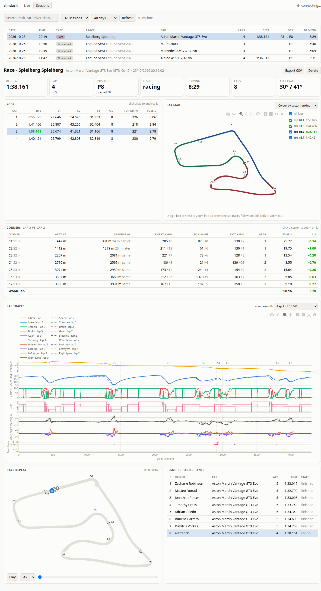
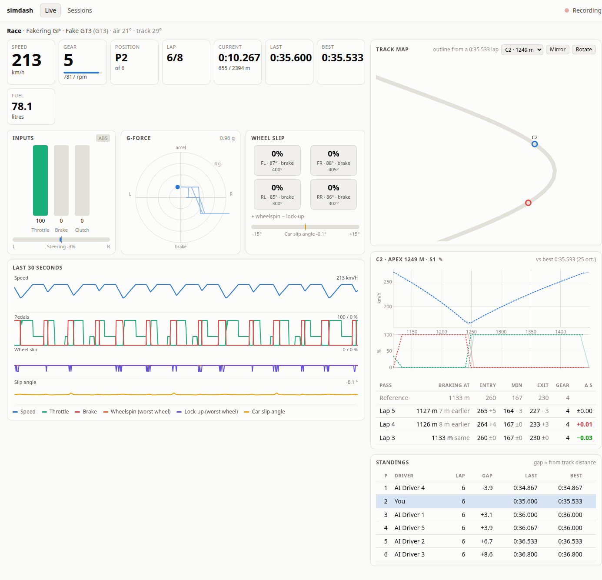

# simdash

Live dashboard and automatic session recorder for Automobilista 2, served by FastAPI.
Open http://127.0.0.1:8050 while it runs.

It is built on [simapi](https://github.com/Spacefreak18/simapi), the sim telemetry
library behind [Monocoque](https://github.com/Spacefreak18/monocoque), the Linux
sim-racing device manager (wheels, pedals, shakers, haptics...). simapi's `simd`
gets AMS2's telemetry out of Proton, and simdash records it and turns it into the
pages below.


*Sessions: a race at Spielberg, lap 3 analysed against lap 2: lap map coloured by sector ranking, corner table with time gained per corner, lap traces with the delta row and sector lines, race replay and results.*


*Live: the dashboard while on track, with the track map focused on one corner and each pass compared with the reference lap (here fed by the built-in fake game, `simdash.fake_ams2`).*

> **About this project:** I have not written any of this code (yet). simdash was
> built entirely through conversations with [Claude Code](https://claude.com/claude-code),
> Anthropic's coding assistant: I described what I wanted, tested it in the car,
> and reported what looked wrong.

Needs Linux, Python 3.10+, and AMS2 running under Proton with
[simd](https://github.com/Spacefreak18/simapi)'s `pcars2bridge` copying the game's
shared memory to `/dev/shm/$pcars2$` (AMS2: Options > System > Shared Memory = Project CARS 2).

## Install

```
make install        # creates .venv, installs ~/.local/bin/simdash
```

```
simdash                    # start (records while AMS2 is on track)
simdash --host 0.0.0.0     # also reachable from a phone/tablet on the LAN
```

## What it shows

- **Live**: speed, gear, RPM, position, lap times, fuel; throttle/brake/clutch/steering;
  G-force circle with a 3 s trail; per-wheel slip (spin / lock) and car slip angle;
  a rolling 30 s chart; a track map with every car; standings with approximate gaps.
  **Corner focus**: pick a corner of your best lap (same track and car, any day) on the track
  map to zoom on it; each pass shows live speed and pedals over the reference and a row with
  braking point, entry / minimum / exit speed and time gained or lost.
- **Sessions**: every recorded session from every day, searchable by track/car and
  filterable by type and day. Per session: laps table (sectors, top speed, fuel),
  lap map coloured by speed / pedals / slip / track limits, lap traces with a second lap
  overlaid, a delta-time row and a track-limits row (left/right tyres on a kerb or off track),
  a corner table (braking point, entry / minimum / exit speed, gear and time gained or lost per
  corner against the compare lap or the session's best; click a corner to zoom on it),
  and compare laps from other sessions and days on the same track layout with the same car,
  corner names and sector lines on the maps and traces, race replay of all cars, results, CSV export, delete.
  Links like `/#session=2026-10-25:3` open a session directly.

## How corners are found

AMS2 gives no corner positions or names, so simdash derives the corners from a lap's speed
along its lap distance: the analysed lap in **Sessions**, your best lap on that track and car
(the reference) in **Live**. The code is `findCorners` and `cornerStats` in `simdash/static/app.js`.

- **Corner:** a speed dip of more than 10 km/h. Going along the lap, once the speed has
  dropped more than 10 km/h below its last peak and then risen more than 10 km/h above its
  lowest point, that lowest point is a corner's **apex**. Fast kinks taken without slowing
  are not corners. Corners are numbered C1, C2... in lap order (not the official turn numbers).
- **Segment:** each corner owns the stretch from the speed peak before it to the speed peak
  after it. The first starts at the lap start, the last ends at the lap end, so the segments
  cover the whole lap and their times add up to the lap time. A segment's time therefore
  includes the straight its exit leads onto.
- **Braking point:** the first sample after the peak before the corner where the brake is above
  20 %, at most 600 m before the apex ("lift" if there is none). 20 % because the brake can read
  6 to 10 % with a foot resting on the pedal.
- **Entry speed** is the speed at the braking point (at the segment start for a lift),
  **min speed** the lowest speed in the segment, **exit speed** the speed 100 m after the apex
  (or at the segment end if sooner), **gear** the lowest gear in the segment.
- **Comparing laps:** the other lap (compare lap, session best, or each live pass) is measured
  over the same segment distances. Δ is the difference in segment time; negative means faster.
- **Names:** corners you name are saved per track layout with their apex distance, and a name
  goes to the corner whose apex is within 80 m of it.
- **Sectors:** where sector 2 and 3 start comes from the sector number AMS2 reports while you
  drive, recorded with every sample.

## Data source

It reads `/dev/shm/$pcars2$` directly (the copy pcars2bridge makes), not `SIMAPI.DAT`,
because that is where the G-forces, wheel speeds and all cars' positions are.
Offsets of every field in `pcars2_offsets.json` are generated from simapi's `pcars2data.h`
(`make offsets SIMAPI_INC=/path/to/simapi/include` regenerates them).
`simdash/static/plotly.min.js` is plotly.js (MIT), vendored so the app works offline.

- G-forces: `mLocalAcceleration`. Assumed frame: X right, −Z forward, so
  accelerating is up and right turns are right on the G circle. Check this on track.
- Wheel slip: AMS2 gives no slip ratio. simdash learns each wheel's
  speed-to-rotation ratio per car while you **coast straight above 50 km/h with no
  pedals for ~2 s** (saved in `wheels.json`), then slip = wheel surface speed vs
  car speed. It shows "learning" until then.
- Map orientation is a guess. Use **Mirror** / **Rotate** on the map once per
  setup (remembered in the browser).

## Storage

`~/.local/share/simdash/` (override with `SIMDASH_DATA`):

| Path | Contents |
|---|---|
| `days/YYYY-MM-DD.sqlite` | one database per day, every shared-memory field in its raw unit (layout below) |
| `tracks/*.json` | track outline from your best clean lap, used for the live map |
| `tracks/*.corners.json` | corner names you gave (AMS2 provides none), matched to corners by apex distance |
| `wheels.json` | learned wheel ratios per car |

A session belongs to the day it started on. A new session starts on a change of
track, car or session type, on a restart, or after returning to the main menu.
Sessions with under 15 s of driving and no completed lap are dropped.
Size is roughly 40 to 100 MB per hour of driving.

Tables, by how often their data changes (full column list in `simdash/store.py`):

| Table | Rows |
|---|---|
| `session` | one per session: track, car, session type, game version, summary (laps, best, result) |
| `track`, `vehicle`, `driver` | names, stored once and referenced by id |
| `participant` | each car in a session: driver, vehicle, player or not |
| `lap` | one per completed player lap: time, sectors, top speed, fuel used |
| `tick` | one per recorded instant (session, timestamp); every time-series row points to one |
| `telemetry` | player car at 20 Hz: inputs, engine, motion vectors, fluids, position |
| `wheel` | 4 rows per 20 Hz tick: suspension, temperatures, pressure, wear, damage, terrain, slip |
| `car_motion` | every car at 2 Hz: position, orientation, speed, lap, race position |
| `player_state`, `player_timing`, `event_state`, `weather`, `car_status` | change logs: a row only when a value changes (flags, damage, settings, compounds, lap and sector times, rules, weather, each car's status) |
| `enum_name` | names of the enum codes (session type, race state, terrain...) |

A change-log row is valid from its tick until the next row for the same session
(and car, for `car_status`). The views `v_sessions`, `v_samples` and `v_results`
join it all back into the shapes the web app uses. Databases from before this
layout are renamed `YYYY-MM-DD.v1.sqlite` on first start and no longer listed.

## Testing without the game

```
SIMDASH_SHM=/dev/shm/simdash-fake SIMDASH_DATA=/tmp/simdash-test .venv/bin/python -m simdash --port 8051 &
SIMDASH_SHM=/dev/shm/simdash-fake .venv/bin/python -m simdash.fake_ams2 --laps 3
```

## Record at every login (optional)

```
install -Dm644 simdash.service ~/.config/systemd/user/simdash.service
systemctl --user daemon-reload && systemctl --user enable --now simdash
```

## Credits

- [Monocoque](https://github.com/Spacefreak18/monocoque) and
  [simapi](https://github.com/Spacefreak18/simapi) by Spacefreak18: the Linux sim-racing
  stack this sits on. simapi's `simd`/`pcars2bridge` exposes AMS2's shared memory and
  its `pcars2data.h` provides the field layout simdash reads.
- [plotly.js](https://github.com/plotly/plotly.js) (MIT) for the charts and maps.
- Code written with [Claude Code](https://claude.com/claude-code).

## License

GPL-3.0, like Monocoque (simapi itself is LGPL-3.0). See [LICENSE](LICENSE).
