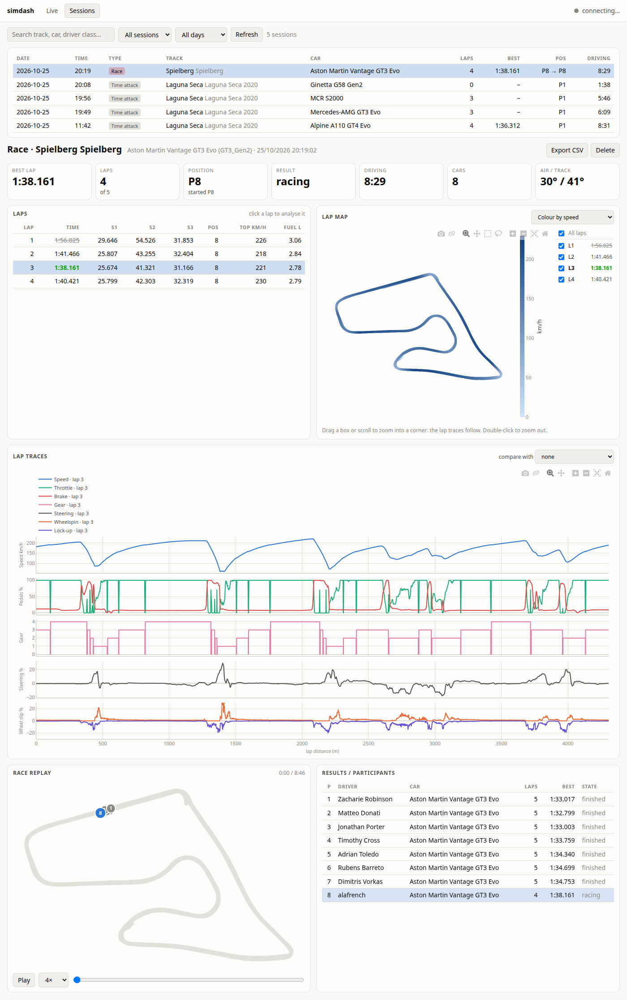
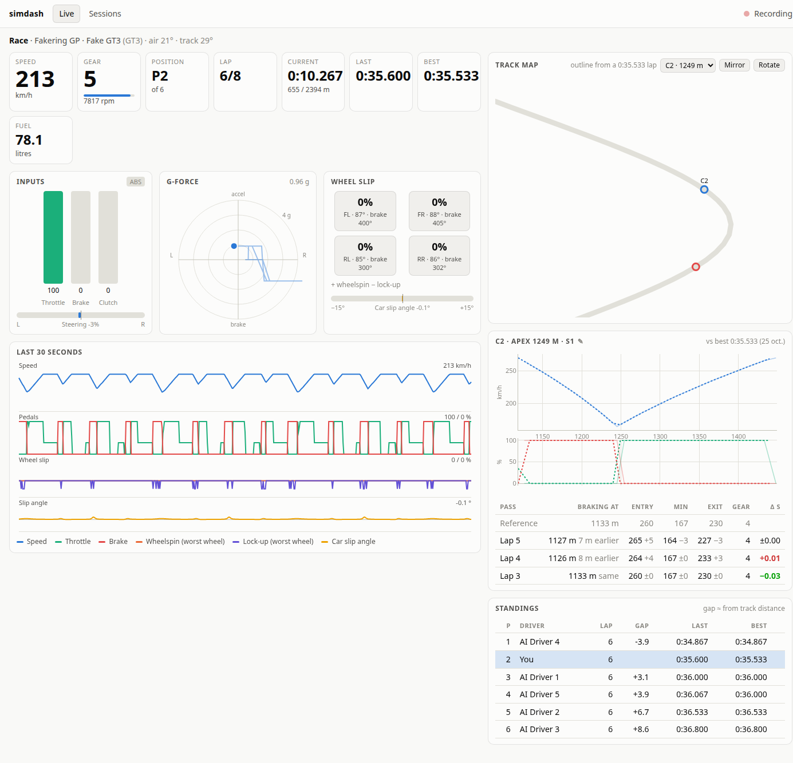
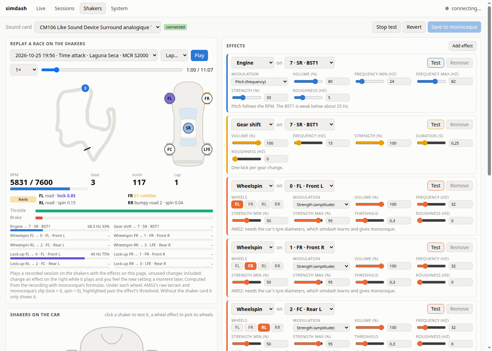
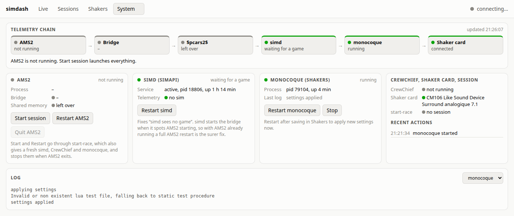

# simdash

Live dashboard and automatic session recorder for Automobilista 2, served by FastAPI.
Open http://127.0.0.1:8050 while it runs.

It is built on [simapi](https://github.com/Spacefreak18/simapi), the sim telemetry
library behind [Monocoque](https://github.com/Spacefreak18/monocoque), the Linux
sim-racing device manager (wheels, pedals, shakers, haptics...). simapi's `simd`
gets AMS2's telemetry out of Proton, and simdash records it and turns it into the
pages below.


*Sessions: a race at Spielberg, lap 3 analysed against lap 2: lap map coloured by sector ranking, corner table with time gained per corner, lap traces with the delta row and sector lines, race replay and results.*


*Live: the dashboard while on track, with the track map focused on one corner and each pass compared with the reference lap (here fed by the built-in fake game, `simdash.fake_ams2`).*


*Shakers: a lap at Laguna Seca replayed on the shakers while the effects are tuned on the right: braking with the front-left wheel locked (its puck lit violet), the front-right on a kerb, the engine on the BST1 under the seat.*


*System: AMS2 closed, simd waiting for a game, monocoque running with the shaker card connected.*

> **About this project:** I have not written any of this code (yet). simdash was
> built entirely through conversations with [Claude Code](https://claude.com/claude-code),
> Anthropic's coding assistant: I described what I wanted, tested it in the car,
> and reported what looked wrong.

Needs Linux, Python 3.10+, and AMS2 running under Proton with
[simd](https://github.com/Spacefreak18/simapi)'s `pcars2bridge` copying the game's
shared memory to `/dev/shm/$pcars2$` (AMS2: Options > System > Shared Memory = Project CARS 2).

## Install

```
make install        # creates .venv, installs ~/.local/bin/simdash
```

```
simdash                    # start (records while AMS2 is on track)
simdash --host 0.0.0.0     # also reachable from a phone/tablet on the LAN
```

## What it shows

- **Live**: speed, gear, RPM, position, lap times, fuel; throttle/brake/clutch/steering;
  G-force circle with a 3 s trail; per-wheel slip (spin / lock) and car slip angle;
  a rolling 30 s chart; a track map with every car and, beside it, the car seen from above with
  each bass shaker lit by what monocoque is playing on it; standings with approximate gaps.
  **Corner focus**: pick a corner of your best lap (same track and car, any day) on the track
  map to zoom on it; each pass shows live speed and pedals over the reference and a row with
  braking point, entry / minimum / exit speed and time gained or lost.
- **Sessions**: every recorded session from every day, searchable by track/car and
  filterable by type and day. Per session: laps table (sectors, top speed, fuel),
  lap map coloured by speed / pedals / slip / track limits, lap traces with a second lap
  overlaid, a delta-time row and a track-limits row (left/right tyres on a kerb or off track),
  a corner table (braking point, entry / minimum / exit speed, gear and time gained or lost per
  corner against the compare lap or the session's best; click a corner to zoom on it),
  and compare laps from other sessions and days on the same track layout with the same car,
  corner names and sector lines on the maps and traces, race replay of all cars (with the car seen from
  above showing which shaker played what at that moment), results, CSV export, delete.
  Links like `/#session=2026-10-25:3` open a session directly.
- **Corner Genie**: a big card that pops up as you leave each corner, over whatever simdash tab
  is open (you can't click while driving), then fades: time gained or lost in the corner and, in
  an entry | apex | exit grid, the braking point, full-throttle point, entry / slowest / exit speed
  and gear, each against your best lap on that track with that car. The tab sets what it shows,
  how big, where and for how long, with a preview and a replay of any recorded lap on a track map.
  Details below. Link: `/#genie`.
- **Shakers**: bass shaker setup for [Monocoque](https://github.com/Spacefreak18/monocoque), plus kerb and
  off-track effects simdash plays itself.
  A top view of the car shows where each channel of the shaker sound card is mounted (seat,
  pedals, each wheel...) and which effects it gets. Each effect (engine, gear shift, wheelspin,
  lock-up, ABS, suspension) gets its shaker, wheels, modulation, frequency, strength, threshold
  and volume, with a **Test** button that plays it as monocoque would; **Identify** pulses one
  channel to find which shaker it is. **Replay** plays a recorded session on the shakers with these
  effects, to tune them on corners you know: track map, RPM, surface under each tyre, wheel slip, and a
  small car with each shaker lit by what it plays.
  Details below. Link: `/#shakers`.
- **Wheel LEDs** (hidden for now, open `/#leds`): a shift light on a Moza wheel's RPM LEDs (tested
  on an old R5 base with the ES rim), driven by simdash, by monocoque, or off, with a pedal test
  that needs no game.
- **System**: the telemetry chain AMS2 → pcars2bridge → `$pcars2$` → simd → monocoque →
  shaker card, plus CrewChief and the race session, each green / yellow / red with the fix for
  the first broken link; buttons to restart simd, restart or stop monocoque, and start, restart
  or quit AMS2; tails of each tool's log. Link: `/#system`.

## How corners are found

AMS2 gives no corner positions or names, so simdash derives the corners from a lap's speed
along its lap distance: the analysed lap in **Sessions**, your best lap on that track and car
(the reference) in **Live**. The code is `findCorners` and `cornerStats` in `simdash/static/app.js`.

- **Corner:** a speed dip of more than 10 km/h. Going along the lap, once the speed has
  dropped more than 10 km/h below its last peak and then risen more than 10 km/h above its
  lowest point, that lowest point is a corner's **apex**. Fast kinks taken without slowing
  are not corners. Corners are numbered C1, C2... in lap order (not the official turn numbers).
- **Segment:** each corner owns the stretch from the speed peak before it to the speed peak
  after it. The first starts at the lap start, the last ends at the lap end, so the segments
  cover the whole lap and their times add up to the lap time. A segment's time therefore
  includes the straight its exit leads onto.
- **Braking point:** the first sample after the peak before the corner where the brake is above
  20 %, at most 600 m before the apex ("lift" if there is none). 20 % because the brake can read
  6 to 10 % with a foot resting on the pedal.
- **Entry speed** is the speed at the braking point (at the segment start for a lift),
  **min speed** the lowest speed in the segment, **exit speed** the speed 100 m after the apex
  (or at the segment end if sooner), **gear** the lowest gear in the segment.
- **Comparing laps:** the other lap (compare lap, session best, or each live pass) is measured
  over the same segment distances. Δ is the difference in segment time; negative means faster.
- **Names:** corners you name are saved per track layout with their apex distance, and a name
  goes to the corner whose apex is within 80 m of it.
- **Sectors:** where sector 2 and 3 start comes from the sector number AMS2 reports while you
  drive, recorded with every sample.

## Corner Genie

As you leave each corner, a card shows how it went against the **reference lap**: your best valid lap
on this track layout with this car, from any day (the same one Live's corner focus uses; it updates
when you set a new best). Corners are those of the reference lap (see above). The card pops up over
any simdash tab, so leave simdash on a screen you can see (a second monitor or a tablet: AMS2 full
screen covers it) and drive.

- **When:** once you are back at full throttle after the apex, at least 120 m and at most 250 m past
  it (or at the next corner's start). A corner gets a card only if simdash saw it from its start, so
  opening the page mid-lap skips the corners already behind you.
- **Top line:** corner name and the time gained or lost from the corner's start to that point.
- **Grid**, columns in driving order *entry | apex | exit*, one row per kind of value:
  - distances: **braking point** in metres before the apex | | **full throttle** (throttle ≥ 95 %)
    in metres after it. Both are measured from the reference lap's apex, so two laps compare only
    where they braked or floored it. ✓ = within 3 m.
  - speeds: **entry** (at the braking point) | **slowest** | **exit** (100 m past the apex), km/h.
  - gear: | the gear held at the slowest point (the most common one within 30 m, since mid-shift
    samples read neutral or a passing gear) |.
- **Colours:** blue = better than the reference (faster, braked later, full throttle sooner), orange =
  worse; the card's edge and the time take the same colour.
- **Settings** (tab *Corner Genie*, saved in `~/.local/share/simdash/genie.json`, shared by every
  screen): on/off, time on screen, position (top / middle / bottom), size (up to about 75 % of the
  screen, text scaled to it), every corner or only where you lose / gain time above a threshold,
  and which values to show (icons double as the legend).
- **Test:** *Show a sample*, or replay a recorded lap at 1×, 2× or 4×: the cards pop up at the moments
  you left each corner, against your best lap ever there, while a track map follows the car and rings
  the corner just reported. The preview box keeps the latest card.

## Bass shakers (Shakers tab)

simdash edits the `Sound` effects of the default entry in `~/.config/monocoque/monocoque.config`
(other devices and per-car entries are kept). Saving rewrites the file with a comment per effect
and keeps the previous one as `monocoque.config.bak-<date-time>`. monocoque reads its config when
it starts: after saving, use **Restart monocoque** on the System tab, or start a new session.

- **Shakers on the car:** where each of the 8 channels (7.1 order FL, FR, FC, LFE, RL, RR, SL, SR)
  is mounted is simdash's own data (`shakers.json`); monocoque only knows channel numbers (`pan`).
- **Tests** are synthesised like monocoque's PulseAudio streams (a sine at `amplitude`%, stream
  volume `volume`%, one channel of 8) and played with `pacat`, only on the shaker card chosen at
  the top: if it is unplugged the test is refused rather than played on the speakers.
- **Wheels:** monocoque's `tyre` takes one wheel, `Fronts`, `Rears` or `All`. Any other set picked
  on the car (one side, a diagonal, three wheels) is saved as one effect per part on the same
  shaker, each 3 Hz above the previous so the sines add up instead of cancelling, tagged with a
  `group` key that monocoque ignores so simdash shows them as one effect again.
- **monocoque plays every effect at 8× its frequency on a 7.1 card** (as of monocoque `47d0c50`): its
  PulseAudio callbacks advance the sine once per 16-bit value instead of once per frame of interleaved
  channels, so a 30 Hz effect comes out at 240 Hz and gear kicks last 1/8 of their duration. The setup
  this was written for runs monocoque with a local fix (one time step per frame, the sample copied to
  every channel); without it, the Tests and the replay here feel lower than the car.
- AMS2 notes shown per effect: wheelspin and lock-up need each car's tyre diameters, which simdash
  gives monocoque (below); ABS probably never fires and suspension gives nothing (simapi does not map
  AMS2's suspension, so kerbs cannot be felt through monocoque).

### Kerbs and off track (played by simdash)

monocoque has no effect for the track surface, and its Suspension effect gets nothing from AMS2, so simdash
adds two effects of its own: **Kerb** (rumble strips, kerbs, drains) and **Off track** (grass, gravel,
sand, runoff...). Each takes any set of wheels and plays while one of them is on that surface, from AMS2's
raw terrain per wheel (`mTerrain`), with its pitch or strength rising with speed (full at 200 km/h).
simdash plays them itself on the shaker card next to monocoque (PulseAudio mixes the two), so they need
simdash running but no monocoque restart: they apply a few seconds after saving. They are saved in
simdash's `effects.json`, never in `monocoque.config`, and show in the replay and on the small cars.

### Shakers on the Live and Sessions maps

The small car next to the Live track map and the session's race replay shows each shaker lit in the
colour of the strongest effect it plays, computed like the replay below. Live uses the settings
monocoque started with (it reads its config only at start). A recorded session uses the settings in force
when it started: saving keeps the previous file as `monocoque.config.bak-<date-time>`, so the first
backup made after the session start holds them (the current file if none). Where each channel sits on
the car comes from today's `shakers.json`, which has no history.

### Replay on the shakers

Pick a recorded session at the top of the Shakers tab, then Play (0.25×, 0.5× or 1×), drag the slider
or jump to a lap. The replay card stays in view while you scroll the effects, and uses them as they are on
the page, unsaved changes included: change a threshold or a strength while it plays and you feel the new
setting a moment later. It shows the track map, a small car with each shaker lit by what it plays, RPM
against the car's max, gear, speed, pedals, each effect's frequency and strength, whether the car is on
track, on a kerb or off track (the worst surface under any tyre, from AMS2's raw terrain), and under each
wheel its terrain name and monocoque's slip (lock > 0, spin < 0), highlighted past the threshold of that
wheel's effect. The code is `simdash/replay.py`.

- Each effect is recomputed from the recorded telemetry (20 Hz, interpolated) with monocoque's formulas:
  engine = `rpm / max rpm`; a gear kick when the gear changes to 1st or above; wheelspin and lock-up from
  each wheel's speed (`tyre diameter × rps / 2`) against the car's, past the threshold, only while moving
  forwards. ABS fires only while AMS2's ABS flag is on; suspension gives nothing, as in the car.
- Tyre diameters come from monocoque's `diameters.config`: `~/.config/monocoque/` up to monocoque `47d0c50`,
  `~/.cache/monocoque/` from `9be899e` on. simdash looks inside the monocoque that `start-monocoque` runs
  (the older path is written in the program) and uses that file only; the first time it writes the new
  one, it carries over the cars monocoque learned in the old one. monocoque only learns
  them itself while coasting above 50 km/h with the brake at exactly 0, which a resting foot never gives,
  so simdash writes the sizes it learns (`wheels.json`, diameter = 2 × radius) into that file, tagged
  `source = "simdash"`: at start and each time it learns or refines a car. Cars monocoque learned itself
  are left alone, and the previous file is kept as `diameters.config.bak-<date-time>`.
- The streams are mixed into one 8-channel signal (stream volumes as PulseAudio applies them) and played
  with `pacat` on the shaker card only. Without the card the replay runs silently for the map and the car.
  Slower replays keep each vibration's pitch and each gear kick's length.

## Wheel LEDs tab

Shelved: its button is hidden and the LEDs are off, but the tab still works at `/#leds`. Note that
monocoque's own Moza drivers send nothing since monocoque `18f043a` (they write only
`if (serialdevice->port)`, a field that commit stopped setting), so only the *simdash* choice
lights the LEDs.

For a Moza base whose rim has RPM LEDs. The frame is monocoque's `MozaR5` one, written to the base's
serial port (`/dev/serial/by-id/usb-Gudsen_MOZA*-if00`): `7e 06 41 13 fd de` + a 4-byte big-endian
mask (bits 0–9 = the 10 LEDs) + checksum (`0x0d` + the sum of the bytes, mod 256). The rim only
listens when boxflat's wheel page → RPM → **RPM Indicator Mode** is **RPM** (“On” is a static
rainbow). Colours stay the ones set in boxflat.

- **Who drives the LEDs:** *simdash* lights them from the live RPM with the shift light settings;
  *monocoque* uses its fixed steps (10–92 % of max RPM, flashing from 94 %); *Off* leaves the rim
  alone. Only one program may write to the port, so monocoque's Moza device is added to
  `monocoque.config` only when monocoque is chosen (with a backup, like the Shakers tab). Restart
  monocoque after switching.
- **Shift light:** the bar starts at a share of the shift point and is full just before it; from
  the shift point all LEDs flash until you change gear (not in top gear, unless asked). The shift
  point is a share of the car's max RPM, or an RPM set per car. Settings in
  `~/.local/share/simdash/leds.json`.
- **Test without the game:** each pedal is an axis of the base's joystick device
  (`/dev/input/by-id/usb-Gudsen_MOZA*-event-joystick`, read with `EVIOCGABS`); the chosen pedal's
  travel stands for RPM / max RPM. *Sweep* runs the bar and the flash on its own.

## System tab

It expects the launchers of the setup it was written for in `~/.local/bin`: `start-race` (one
session: restarts simd, starts CrewChief, AMS2 through Steam and monocoque, stops them when AMS2
exits; logs in `~/.local/state/`), `start-monocoque` and `simtelemetry` (simd's data check).
simd runs as the systemd user service `simd`. **Start session** and **Restart AMS2** run
`start-race`; **Quit AMS2** ends the game process and waits for `start-race` to clean up.
Opening the page on the game PC while AMS2 runs moves the focus away from AMS2, which then loses
the wheel: use it from a phone or tablet (`simdash --host 0.0.0.0`) during a race.

A restarted simd deletes `/dev/shm/SIMAPI.DAT` and creates a new one, so a monocoque started before it
keeps reading the old copy, which no longer changes, and plays nothing that follows the race.
**Restart simd** therefore restarts a running monocoque too, and monocoque shows red ("reads an old simd")
when it still maps a deleted `SIMAPI.DAT`. The `start-race` used here also stops such a monocoque after
restarting simd, before starting its own.

## Data source

It reads `/dev/shm/$pcars2$` directly (the copy pcars2bridge makes), not `SIMAPI.DAT`,
because that is where the G-forces, wheel speeds and all cars' positions are.
Offsets of every field in `pcars2_offsets.json` are generated from simapi's `pcars2data.h`
(`make offsets SIMAPI_INC=/path/to/simapi/include` regenerates them).
`simdash/static/plotly.min.js` is plotly.js (MIT), vendored so the app works offline.

- G-forces: `mLocalAcceleration`. Assumed frame: X right, −Z forward, so
  accelerating is up and right turns are right on the G circle. Check this on track.
- Wheel slip: AMS2 gives no slip ratio. simdash learns each wheel's
  speed-to-rotation ratio per car while you **coast straight above 50 km/h with no
  pedals for ~2 s** (saved in `wheels.json`), then slip = wheel surface speed vs
  car speed. It shows "learning" until then.
- Map orientation is a guess. Use **Mirror** / **Rotate** on the map once per
  setup (remembered in the browser).

## Storage

`~/.local/share/simdash/` (override with `SIMDASH_DATA`):

| Path | Contents |
|---|---|
| `days/YYYY-MM-DD.sqlite` | one database per day, every shared-memory field in its raw unit (layout below) |
| `tracks/*.json` | track outline from your best clean lap, used for the live map |
| `tracks/*.corners.json` | corner names you gave (AMS2 provides none), matched to corners by apex distance |
| `wheels.json` | learned wheel ratios per car |
| `shakers.json` | where each shaker sound card channel is mounted on the car (Shakers tab) |

A session belongs to the day it started on. A new session starts on a change of
track, car or session type, on a restart, or after returning to the main menu.
Sessions with under 15 s of driving and no completed lap are dropped.
Size is roughly 40 to 100 MB per hour of driving.

Tables, by how often their data changes (full column list in `simdash/store.py`):

| Table | Rows |
|---|---|
| `session` | one per session: track, car, session type, game version, summary (laps, best, result) |
| `track`, `vehicle`, `driver` | names, stored once and referenced by id |
| `participant` | each car in a session: driver, vehicle, player or not |
| `lap` | one per completed player lap: time, sectors, top speed, fuel used |
| `tick` | one per recorded instant (session, timestamp); every time-series row points to one |
| `telemetry` | player car at 20 Hz: inputs, engine, motion vectors, fluids, position |
| `wheel` | 4 rows per 20 Hz tick: suspension, temperatures, pressure, wear, damage, terrain, slip |
| `car_motion` | every car at 2 Hz: position, orientation, speed, lap, race position |
| `player_state`, `player_timing`, `event_state`, `weather`, `car_status` | change logs: a row only when a value changes (flags, damage, settings, compounds, lap and sector times, rules, weather, each car's status) |
| `enum_name` | names of the enum codes (session type, race state, terrain...) |

A change-log row is valid from its tick until the next row for the same session
(and car, for `car_status`). The views `v_sessions`, `v_samples` and `v_results`
join it all back into the shapes the web app uses. Databases from before this
layout are renamed `YYYY-MM-DD.v1.sqlite` on first start and no longer listed.

## Testing without the game

```
SIMDASH_SHM=/dev/shm/simdash-fake SIMDASH_DATA=/tmp/simdash-test .venv/bin/python -m simdash --port 8051 &
SIMDASH_SHM=/dev/shm/simdash-fake .venv/bin/python -m simdash.fake_ams2 --laps 3
```

## Record at every login (optional)

```
install -Dm644 simdash.service ~/.config/systemd/user/simdash.service
systemctl --user daemon-reload && systemctl --user enable --now simdash
```

## Credits

- [Monocoque](https://github.com/Spacefreak18/monocoque) and
  [simapi](https://github.com/Spacefreak18/simapi) by Spacefreak18: the Linux sim-racing
  stack this sits on. simapi's `simd`/`pcars2bridge` exposes AMS2's shared memory and
  its `pcars2data.h` provides the field layout simdash reads.
- [plotly.js](https://github.com/plotly/plotly.js) (MIT) for the charts and maps.
- Code written with [Claude Code](https://claude.com/claude-code).

## License

GPL-3.0, like Monocoque (simapi itself is LGPL-3.0). See [LICENSE](LICENSE).
