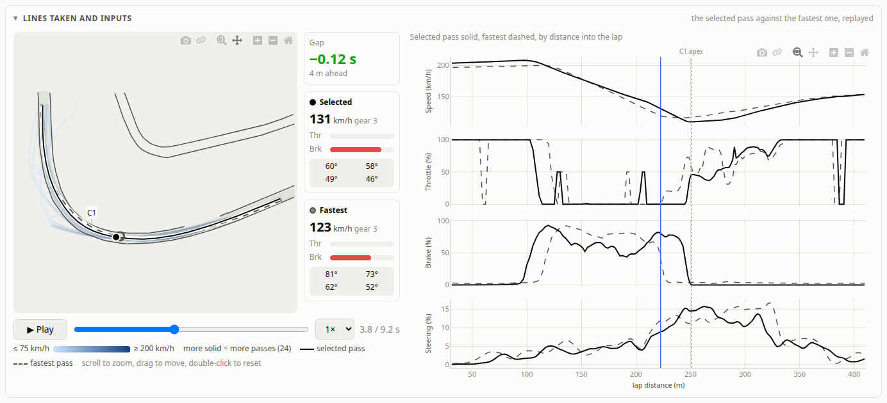

# simdash

Live dashboard, session recorder and driving coach for Automobilista 2 on Linux, served by FastAPI.
Open http://127.0.0.1:8050 while it runs.

It sits on [simapi](https://github.com/Spacefreak18/simapi), the telemetry library behind
[Monocoque](https://github.com/Spacefreak18/monocoque) (the Linux sim-racing device manager):
simapi's `simd` gets AMS2's telemetry out of Proton, simdash records every session and turns it into
the pages below.


*Corner Genie at Brands Hatch: every recorded pass through Paddock Hill as a heatmap coloured by speed, a pass replayed against the fastest one (0.12 s up, 4 m ahead at this point), and both passes' inputs.*

> **About this project:** I have not written any of this code (yet). simdash was built entirely through
> conversations with [Claude Code](https://claude.com/claude-code), Anthropic's coding assistant:
> I described what I wanted, tested it in the car, and reported what looked wrong.

## Features

| Page | What it does |
|---|---|
| [Live](docs/live.md) | Speed, gear, RPM, pedals, G-forces, wheel slip, track map with every car, standings; zoom on a corner and compare each pass with your best lap. |
| [Sessions](docs/sessions.md) | Every recorded session: laps and sectors, lap map, corner table, lap traces against any lap (any day), race replay of all cars, results, CSV export. |
| [Progress](docs/progress.md) | One track and car over every session: best lap, best sectors, median and spread, time per corner against your best ever. |
| [Corner Genie](docs/corner-genie.md) | A card after each corner while you drive (time, braking point, speeds, a tip). Every pass through a corner compared, any car, with a speed heatmap of the lines, a replay and the inputs. |
| [Track edges](docs/track-edges.md) | Map where each track really ends by driving over its edges; natural colours, altitude profile, 3D. |
| [Shakers](docs/shakers.md) | Bass shaker setup for Monocoque on a top view of the car, kerb and off-track effects, replay of a session on the shakers. |
| [System](docs/system.md) | The telemetry chain from AMS2 to the shakers, each link green / yellow / red, restart buttons, logs, database size. |
| [Wheel LEDs](docs/wheel-leds.md) | Shift light on a Moza rim's RPM LEDs (shelved, at `/#leds`). |

How corners are detected and measured, used by most pages: [corners](docs/corners.md).
Where the data comes from and how the databases are laid out: [data and storage](docs/data.md).
To analyse it in Jupyter (pandas, matplotlib), start from [`notebooks/simdash_template.ipynb`](notebooks/simdash_template.ipynb).

## Install and run

Needs Linux, Python 3.10+, and AMS2 under Proton with simd's `pcars2bridge` copying the game's shared
memory to `/dev/shm/$pcars2$` (AMS2: Options > System > Shared Memory = Project CARS 2).

```
make install               # creates .venv, installs ~/.local/bin/simdash
simdash                    # start: records while AMS2 is on track
simdash --host 0.0.0.0     # also reachable from a phone or tablet on the LAN
```

Record at every login (optional):

```
install -Dm644 simdash.service ~/.config/systemd/user/simdash.service
systemctl --user daemon-reload && systemctl --user enable --now simdash
```

Links open a page directly: `/#session=2026-10-25:3`, `/#progress`, `/#genie`, `/#edges`, `/#shakers`,
`/#system`. Testing without the game: see [data and storage](docs/data.md#testing-without-the-game).

## Credits

- [Monocoque](https://github.com/Spacefreak18/monocoque) and [simapi](https://github.com/Spacefreak18/simapi)
  by Spacefreak18: the Linux sim-racing stack this sits on. simapi's `simd`/`pcars2bridge` exposes AMS2's
  shared memory and its `pcars2data.h` provides the field layout simdash reads.
- [plotly.js](https://github.com/plotly/plotly.js) (MIT) for the charts and maps, vendored so the app works offline.
- Code written with [Claude Code](https://claude.com/claude-code).

## License

GPL-3.0, like Monocoque (simapi itself is LGPL-3.0). See [LICENSE](LICENSE).
