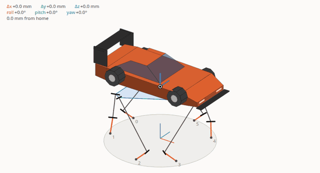
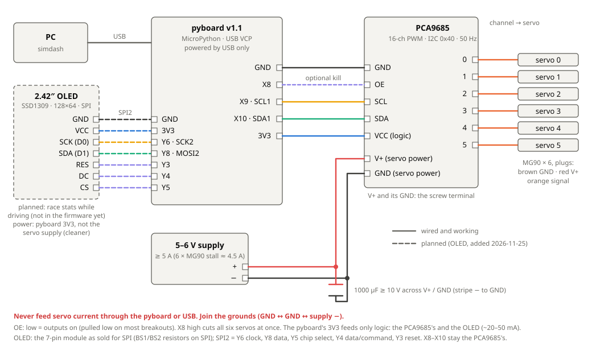

# Desk 6DOF

[← simdash](../../README.md)

A small Stewart platform on six hobby servos with a model car on top, moving on the desk as the car
moves in AMS2. A toy and a test bench for motion cueing: no seat, no rider.

**Status (2026-11-22):** design stage. The servos (6 × MG90) are on order, the PCA9685 and the pyboard
are on hand, parts to be designed and 3D printed. simdash has a **6DOF** tab (`/#motion`) to design the geometry, print 1:1 templates, jog the platform by hand, calibrate the servos and
**play a recorded session** on it (Play a course: track map with the car's position, and the car seen from
above with the shakers and pedal haptics that fired at that moment, as recorded by the haptics engine or
recomputed with that day's settings). The geometry is locked unless *Unlock to edit* is ticked (it locks again
when leaving the tab). Nothing drives it live from the game yet.

The geometry is set the way it is drawn in CAD (FreeCAD): base radius to the servo shafts and the angle between
the two shafts of a pair, platform radius and angle between the two joints of a pair, rod and horn length; plus
how the servos sit (each shaft's own angle from radial, horns pointing away from or at each other, bodies lying or
upright) and how they are used (horn angle at home, stroke ± from it). The 1:1 SVGs carry those dimensions and
every point's coordinates. See [Geometry](geometry.md).

**Move it** has two modes: *Platform pose* (x, y, z, roll, pitch, yaw; each servo follows) and *Servos
directly* (each horn's angle from home; the platform follows, found by forward kinematics). Either way the same
limits apply before anything is sent.

**The 3D view:** a dropdown picks the viewpoint (Iso front left / rear right, Front, Back, Left, Right, Top),
a slider turns it around the vertical axis (handy to judge the rods' lean and the ball joints' swivel), and
dragging turns it freely. A reference point marks the platform's centre against its home position: the path
there leg by leg (x red, y green, z blue), the platform's own axes beside the home axes, and a readout of
Δx, Δy, Δz, roll, pitch, yaw and the distance from home.




| Page | What's in it |
|---|---|
| [Hardware](hardware.md) | Parts list, wiring, power, the pyboard's pins. |
| [Geometry](geometry.md) | The parameters, the inverse kinematics, how far it moves, designing the printed parts. |
| [Firmware](firmware.md) | The MicroPython program on the pyboard and the serial protocol. |
| [Motion cueing](cueing.md) | Plan: from AMS2's telemetry to a pose (not built yet). |



## How the pieces fit

```
AMS2 ──shared memory──▶ simdash (PC)                                  pyboard v1.1           PCA9685      6 × MG90
                        pose (x y z roll pitch yaw)                    MicroPython            50 Hz PWM
                        → inverse kinematics → 6 horn angles   ──USB──▶ "S 1500 … 1500\n"  ──I2C──▶ ch 0–5  ──▶ horns
                        → calibration → 6 pulse widths (µs)            clamp, write, watchdog
```

All the maths lives in simdash (`simdash/motion.py`), where it is easy to change and to test; the
pyboard only clamps the six pulses, writes them, and lets go of the servos when nothing arrives for a second.

## On / off

The System tab has a **Desk 6DOF** card: whether the board is plugged in, its firmware, the servos (armed or
limp), the pulses and a playing course, with *Let go of the servos* and *Turn off* / *Turn on*. Off (kept as
`"enabled": false` in `motion.json`): a playing course stops, the servos let go, the 6DOF tab is hidden, and the
API refuses whatever would move the servos or write to the board (409). The settings are kept.

## Plan

1. **Build and jog** (now): design and print the base, platform and rods; wire it; flash the firmware;
   calibrate each servo (level, +45°, −45°) in the tab; move it with the sliders (pose or servos directly) and the Demo.
2. **Replay** (built 2026-11-21): *Play a course* runs a recorded session through the cueing at 50 Hz
   (inputs interpolated from the 20 Hz telemetry), so the cueing can be tuned at the desk without driving.
3. **Live:** the haptics engine (already reading AMS2 at 100 Hz) feeds the cueing; the platform follows the race.
4. Later, maybe: smoother bus servos (Feetech STS3215), a bigger platform.

## Files

| Where | What |
|---|---|
| `simdash/motion.py` | Geometry, inverse kinematics, reach, 1:1 SVG templates, serial link to the pyboard. Settings in `~/.local/share/simdash/motion.json`. |
| `simdash/static/6dof-wiring.svg` | The wiring diagram (also shown in the tab). |
| `firmware/6dof/` | `main.py`, `board.py` (speed limit, park, glide), `fw.py` (PC / demo / USR / LEDs), `demo.py` (standalone demo player) and `pca9685.py` for the pyboard. |
| `simdash/pyboard.py` | Copies files to the board through its raw REPL (no mpremote needed). |
| `tests/test_motion.py`, `tests/test_firmware.py` | IK and joint limits, calibration, cueing (both modes, fades, soft limits), telemetry signs on a recorded lap, the link against a fake pyboard; the firmware logic under CPython. |

API: `GET/PUT /api/motion` (settings + design numbers), `POST /api/motion/pose` (solve a pose; sent to the
pyboard when the servos are armed and the pose is reachable), `POST /api/motion/arm` `{on}`,
`GET/POST /api/motion/replay` (`{action: load|play|pause|seek|stop}`), `POST /api/motion/raw` `{servo, us}` (calibration), `POST /api/motion/demo` `{ref, what, lap, from_s, to_s}`,
`GET /api/motion/demo.bin`, `POST /api/motion/demo/write`,
`GET /api/motion/template/{base|platform}.svg`.
