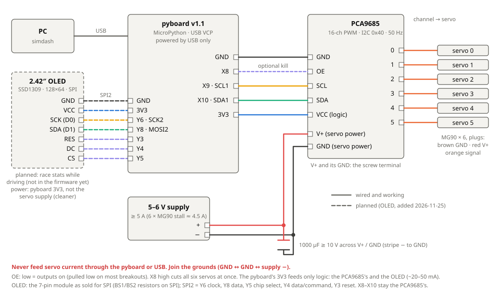

# Desk 6DOF: hardware

[← Desk 6DOF](README.md)

## Parts

| Part | Have | Notes |
|---|---|---|
| 6 × MG90 metal-gear micro servo | on order | ~2 kg·cm at 4.8 V, ~0.1 s/60°, ~180° travel, 3-pin plug (brown GND, red V+, orange signal). Analog: 50 Hz. Pulses kept within 800–2200 µs (end stops near 600 / 2400). Calibrated per servo in the tab: level, +45°, −45° against a printed 45° gauge. |
| PCA9685 16-channel PWM board | yes | I2C address 0x40 by default. Logic VCC 3.3 V from the pyboard, servo power on the V+ screw terminal. |
| pyboard v1.1 (MicroPython) | yes | USB serial to the PC; I2C 1 on X9/X10. |
| 2.42″ OLED, SSD1309, 128×64, SPI (7 pins) | yes | Planned: race stats while driving (not in the firmware yet). On SPI2 (Y side), 3.3 V logic; monochrome, so the whole screen is a 1 kB buffer sent in about 1 ms. Its SDA moves to Y7 (was Y8, now the status ring's) to make room for the ring below. |
| micro-SD card | planned | In the pyboard's own slot. Firmware 6 mounts it at `/sd` (and `SKIPSD` keeps the board from booting off it): whole-race demos, later the track map for the display. |
| WS2812B RGB LED ring, 12 pixels, 5 V | yes | Status ring: the car's acceleration direction and size while a course plays, a rotating rainbow otherwise (firmware 7, `ring.py`). Single data-in pin, daisy-chained internally; needs real hardware to confirm the timing (see firmware.md). |
| 5–6 V supply, ≥ 5 A | to get | A 5 V 5 A brick or a 6 V supply (MG90 is a bit stronger and faster at 6 V). |
| 1000 µF ≥ 10 V electrolytic | to get | Across V+/GND at the PCA9685: servo current comes in spikes. |
| 12 × M3 ball-joint rod ends | to get | RC car linkage ends (or ball studs + sockets). One per rod end. |
| 6 × rods | to get / print | M3 threaded rod cut to length, or printed rods with ball sockets; equal lengths matter more than the exact length. |
| Servo horns | with the servos | Single-arm horn, rod hole at the horn length (18 mm by default); drill / pick the hole that matches. |
| Base, platform, servo brackets, car mount | to print | From the 1:1 templates in the tab. |
| Dupont wires, screws M2/M3 | | |

Budget beyond what's on hand: roughly €20–30 (supply, capacitor, rod ends, rod).

## Wiring

| From | To | Why |
|---|---|---|
| pyboard **X9** (SCL1) | PCA9685 **SCL** | I2C clock |
| pyboard **X10** (SDA1) | PCA9685 **SDA** | I2C data |
| pyboard **3V3** | PCA9685 **VCC** | PCA9685 logic only (a few mA) |
| pyboard **GND** | PCA9685 **GND** | common ground for the signals |
| pyboard **X8** | PCA9685 **OE** | optional: high = all outputs off (hardware kill). Leave it out and OE stays low (enabled) on most breakouts |
| supply **+** | PCA9685 **V+** terminal | servo power |
| supply **−** | PCA9685 **GND** terminal | servo ground (the board joins it to the logic GND) |
| PCA9685 channels **0–5** | servos **0–5** | servo k = PCA9685 channel k, numbered as in the tab |

The status ring, on the pyboard's SPI2 (the OLED's pins, see below, since it isn't wired yet):

| From | To | Why |
|---|---|---|
| pyboard **Y8** (MOSI2) | ring **DIN** | the single data line (firmware 7, `ring.py`: WS2812 timing through the SPI hardware, not bit-banged in software) |
| supply **+** (5 V) | ring **5V** | power: up to ~60 mA a pixel at full white, 12 pixels could pull ~0.7 A — from the servo supply, not the pyboard |
| supply **−** | ring **GND** | ground (joined to the rest, see below) |

The OLED (planned, the firmware doesn't drive it yet), on the pyboard's SPI2, away from the PCA9685's pins:

| OLED pin | pyboard | Why |
|---|---|---|
| **GND** | **GND** | ground |
| **VCC** | **3V3** | power (~20–50 mA). Chosen over the servo supply's 5 V (the module's regulator would take it): the servos' current spikes can reset the display mid-race, the 3V3 is clean and the display goes on and off with the board |
| **SCK** (D0) | **Y6** (SCK2) | SPI clock |
| **SDA** (D1) | **Y7** (MISO2, repurposed) | SPI data (the pin is called SDA on the module, but it is SPI here). Was planned for Y8, now the ring's data line: a free pin (bit-banged or another SPI) is needed here once the OLED is actually wired |
| **RES** | **Y3** | reset (the SSD1309 needs a reset pulse at start-up) |
| **DC** | **Y4** | data / command |
| **CS** | **Y5** | chip select |

- Keep the module in SPI mode (as sold for SPI: the BS1/BS2 resistors on the back). The I2C mode would also
  work on X9/X10, but a full screen takes ~25 ms at 400 kHz there, longer than a servo tick.

- **Never power the servos (or the ring) from the pyboard or USB.** Six MG90s can pull 3–4.5 A when they
  stall or start together, and a bright ring adds up to ~0.7 A more; USB gives 0.5 A and the pyboard's
  regulator far less.
- The grounds must be joined (pyboard GND ↔ PCA9685 GND ↔ supply −), or the signals have no reference.
- The pyboard's I2C 1 also has the on-board accelerometer (address 0x4C); no clash with the PCA9685 (0x40).
  The pyboard has pull-ups on X9/X10, so do most PCA9685 breakouts: fine together.
- Servo numbering follows the geometry: pairs go anticlockwise from the nose seen from above
  (0–1 under the nose, 2–3 rear left, 4–5 rear right with the defaults). See the base template.

## Power numbers

- MG90 at rest holding: ~10–150 mA each depending on load; moving: ~250–400 mA; stall ~700–800 mA.
- A small model car (100–400 g) on an ~100 mm platform is light work for six MG90s; most current goes into
  accelerating the servos themselves.
- Supply voltage: 4.8–6 V. Above 6 V most MG90s are out of spec.
- The ring is small next to that: ~20 mA a pixel typical (a couple of pixels lit for the G-meter, or the
  rainbow, both well under full white on every pixel), ~60 mA a pixel worst case, so well under 1 A for 12.
