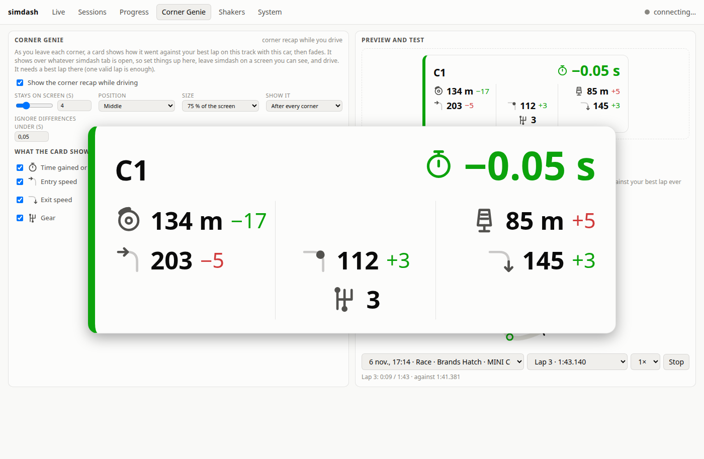
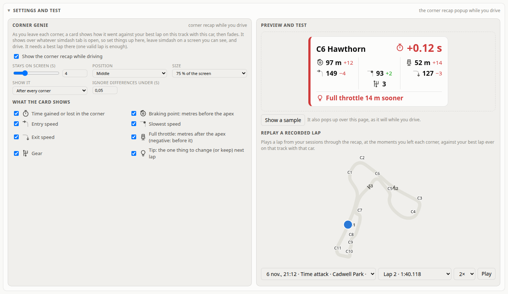
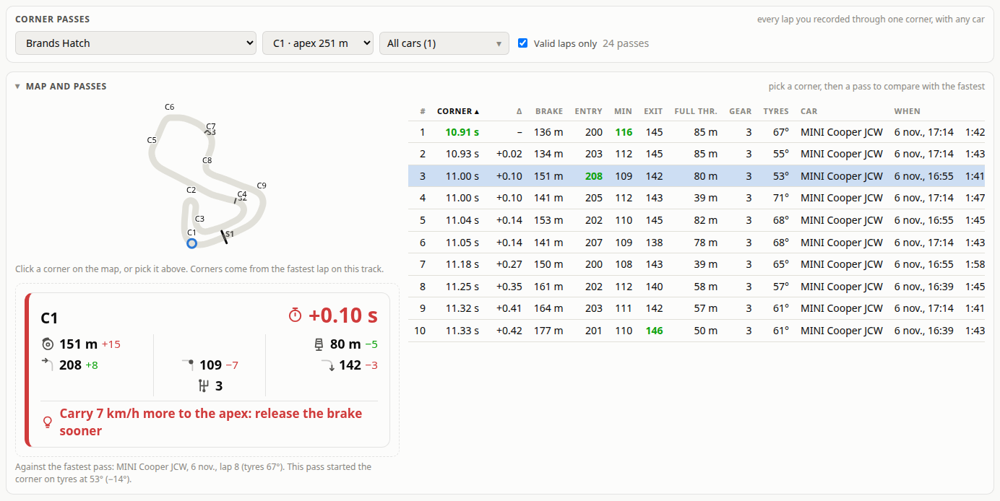
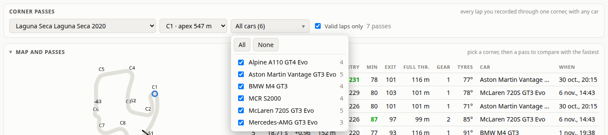
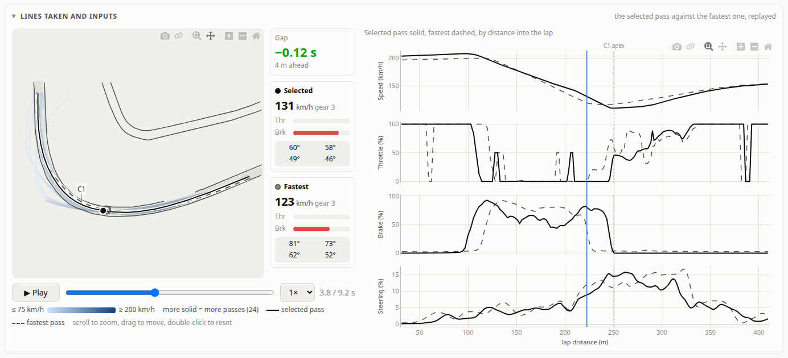
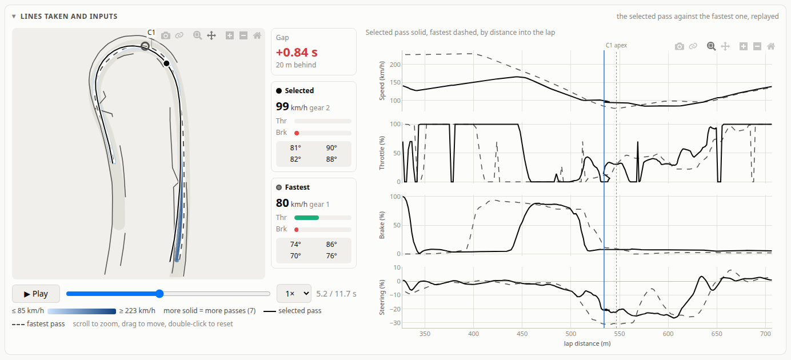

# Corner Genie

[← simdash](../README.md)

Two tools around one corner at a time: a **popup** that tells you how each corner went while you drive,
and **corner passes**, which compares every time you drove through a corner, with any car. Link: `/#genie`.

The tab has a filter bar on top and three sections that fold: *Map and passes*, *Lines taken and inputs*,
and *Settings and test* for the popup. Each one remembers whether you left it open.

## The popup while driving

*Paddock Hill (C1) at Brands Hatch, replayed from a race against the best lap ever there: 0.05 s gained,
braked 17 m later and back to full throttle 5 m later, 5 km/h slower in but faster at the apex and out,
3rd gear. Green is better, red worse.*

As you leave each corner, a card shows how it went against the **reference lap**: your best valid lap on
this track layout with this car, from any day (the same one [Live](live.md)'s corner focus uses; it
updates when you set a new best). It pops up over whatever simdash tab is open, then fades, so leave
simdash on a screen you can see (a second monitor or a tablet: AMS2 full screen covers it) and drive.

- **When:** once you are back at full throttle after the apex, at least 120 m and at most 250 m past it
  (or at the next corner's start). A corner gets a card only if simdash saw it from its start, so opening
  the page mid-lap skips the corners already behind you.
- **Top line:** corner name and the time gained or lost from the corner's start to that point.
- **Grid**, columns in driving order *entry | apex | exit*, one row per kind of value:
  - distances: **braking point** in metres before the apex | | **full throttle** (throttle ≥ 95 %) in
    metres after it. Both are measured from the reference lap's apex, so two laps compare only where they
    braked or floored it. ✓ = within 3 m.
  - speeds: **entry** (at the braking point) | **slowest** | **exit** (100 m past the apex), km/h.
  - gear and wear: | the gear held at the slowest point | **tyre wear** of the most worn tyre (% and which
    tyre; red when more worn than the reference). Live, the reference's wear is not known, so only yours shows.
    Hidden when AMS2 tyre wear is off (it then stays at 0).
- **Tip:** one line with the single thing to change next lap, or to keep. It is not a language model: every
  difference with the reference is scored in rough "tenths" (10 m of braking or throttle point ≈ 3 km/h of
  speed) and the biggest one is put in words: *Brake 25 m later*, *Carry 7 km/h more to the apex: release
  the brake sooner*, *Full throttle 14 m sooner*, *Overbraked 20 m late: brake earlier, roll more speed*,
  *Try gear 3 like your best*... When time was gained it says what to keep (*Braked 15 m later: keep it*).
- **Colours:** the classic timing ones: green = better than the reference, red = worse; the card's edge
  and the time take the same colour.

### Settings and test

- Saved in `~/.local/share/simdash/genie.json`, shared by every screen: on/off, time on screen, position
  (top / middle / bottom), size (up to about 75 % of the screen, text scaled to it), every corner or only
  where you lose / gain time above a threshold, and which values to show (icons double as the legend).
- **Show a sample**, or **replay a recorded lap** at 1×, 2× or 4×: the cards pop up at the moments you left
  each corner, against your best lap ever there, while a track map follows the car and rings the corner
  just reported. The preview box keeps the latest card.

## Corner passes

Every lap you recorded through one corner, from every day and every car. Pick the track and the corner
in the filter bar (or click a corner on the map), tick the cars to include, and choose whether invalid
laps count.

*Paddock Hill (C1), 24 passes. The selected pass (3rd) lost 0.10 s to the fastest: braked 15 m earlier
and was 7 km/h slower at the apex, hence the tip. It also started the corner on tyres 14° colder.*

- **Tracks** carry their country's flag and are grouped by country (the Sessions and Progress tabs too); the country list (with the number of
  tracks in each) narrows the track list down and is remembered. AMS2 does not send the country, so it comes
  from a table of AMS2 circuits (`TRACK_COUNTRY` in `static/app.js`); a track missing from it shows 🏁 under
  *Other*: add a line there for it.
- **Corners** come from the fastest detailed lap on the track, with any car, and keep the names you gave
  them ([how corners are found](corners.md)).
- **Table** (10 rows, then it scrolls): corner time, gap to the fastest pass shown, braking point, entry /
  slowest / exit speed, full-throttle point, gear, **tyre temperature** as the corner starts (average of
  the four; hover for each tyre), **tyre wear** of the most worn tyre (hover for each tyre, — when wear
  was off), **tyre height** at the apex (AMS2 `mTyreY`, the tyre's height in the car's frame, mm:
  average of the four, hover for each tyre), car, date and lap time. The best value of each column is green. Click a
  header to sort, click a row to select that pass.
- **Card:** the selected pass as the popup would show it, against the fastest pass shown, tip included;
  under it, which pass is the fastest and how the tyre temperatures, wear and heights at the apex compare.
- **Cars:** a dropdown of checkboxes with the number of passes per car, *All* and *None*.

- **Low detail:** laps from old, slimmed days keep about one sample every 20 m
  ([storage](data.md#old-days-slimmed-and-compressed)); their passes are shown in grey italics, their
  values are approximate and never count as a column's best.

## Lines taken and inputs

The selected pass against the fastest one, on the line they took and in what the driver did.

*Replay paused at 3.8 s: the selected pass (solid dot) is 0.12 s and 4 m ahead of the fastest one (ring),
still braking at 80 % where the fastest is at 65 %; the blue cursor marks the same moment in the inputs.*

- **Heatmap** of the lines taken, from the braking zone to the exit: every pass is drawn as a 2 m wide
  band. The more passes go through a spot, the more solid it gets, so the line you usually take stands out;
  the colour is the corner time of the **fastest pass through that spot**, so the quickest line comes out in
  the strong colour (dark blue in the light theme, light blue in the dark one) and stays solid even if you
  took it only once, while slower lines fade. The scale runs from the fastest pass shown to the 75th
  percentile of the corner times, at most 1 s slower, so spins and slow laps do not wash it out. Track edges show where they are mapped.
  Hover for the passes, the fastest time through a spot and the average speed there, or for speed and lap
  distance along the two lines.
- **Zoom** with the Plotly toolbox: scroll to zoom, drag to pan, double-click or the home button to reset.
  The zoom stays while you change pass, cars or filters.
- **Replay:** ▶ Play runs both passes side by side in time from the same start, at ¼×, ½× or 1×; the
  slider moves to any moment. The panel beside the map shows the **gap** (how much later or sooner the
  selected pass reached its spot, and how many metres behind or ahead it is), and for each pass the speed,
  gear, throttle, brake, the four **tyre temperatures** and, under them, the four **tyre heights** in mm (fronts on top).
- **Inputs:** speed, throttle, brake and steering of both passes along the lap distance (selected solid,
  fastest dashed), the apex dotted, and a cursor that follows the replay. Hover to read all values at one
  distance.

*Laguna Seca's first corner with all six cars: the selected pass is 0.84 s and 20 m behind the fastest;
it arrived slower and braked much later.*
