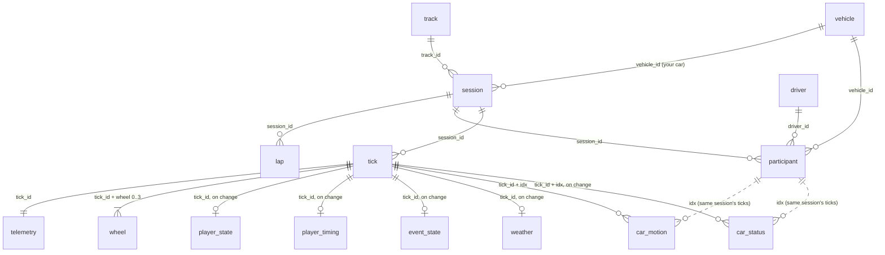

# Data and storage

[← simdash](../README.md)

## Data source

simdash reads `/dev/shm/$pcars2$` directly (the copy pcars2bridge makes), not `SIMAPI.DAT`, because that is
where the G-forces, wheel speeds and all cars' positions are. Offsets of every field in
`pcars2_offsets.json` are generated from simapi's `pcars2data.h`
(`make offsets SIMAPI_INC=/path/to/simapi/include` regenerates them).

- **G-forces:** `mLocalAcceleration`. Assumed frame: X right, −Z forward, so accelerating is up and right
  turns are right on the G circle.
- **Wheel slip:** AMS2 gives no slip ratio. simdash learns each wheel's speed-to-rotation ratio per car while
  you **coast straight above 50 km/h with no pedals for ~2 s** (saved in `wheels.json`), then slip = wheel
  surface speed vs car speed. It shows "learning" until then. The same sizes feed monocoque's tyre diameters
  ([Shakers](shakers.md#tyre-diameters-for-monocoque)).
- **Map orientation** is a guess: use **Mirror** / **Rotate** on the map once per setup (remembered in the browser).

## Storage

`~/.local/share/simdash/` (override with `SIMDASH_DATA`):

| Path | Contents |
|---|---|
| `days/YYYY-MM-DD.sqlite` | one database per day, every shared-memory field in its raw unit (layout below) |
| `days/YYYY-MM-DD.sqlite.zst` + `.summary.sqlite` | a day older than 7 days, slimmed and compressed (below) |
| `tracks/*.json` | track outline from your best clean lap, used for the live map |
| `tracks/*.corners.json` | corner names you gave (AMS2 provides none), matched to corners by apex distance |
| `tracks/*.edges.json` | track edge samples ([Track edges](track-edges.md)) |
| `wheels.json` | learned wheel sizes per car |
| `shakers.json`, `effects.json` | where each shaker channel is mounted; simdash's own kerb and off-track effects |
| `genie.json`, `leds.json`, `mapping.json` | Corner Genie popup, Wheel LEDs and edge mapping settings |

A session belongs to the day it started on. A new session starts on a change of track, car or session type,
on a restart, or after returning to the main menu. Sessions with under 15 s of driving and no completed lap
are dropped. Size is roughly 40 to 100 MB per hour of driving while a day is recent.

## Databases

Everything recorded lives in SQLite files, **one database per day**. There is no central database: the
session list, Progress, Corner passes and the best-lap lookups open every day in turn and match sessions
by name (track, layout, car).

### The files

| File | What it is | Written by |
|---|---|---|
| `days/YYYY-MM-DD.sqlite` (+ `-wal`, `-shm`) | the day's database: every session that **started** that day, in full detail. WAL mode, so the web app reads while the recorder writes. `PRAGMA user_version` = schema version (2) | the recorder, live |
| `days/YYYY-MM-DD.sqlite` with a `slimmed` table | the same file once slimmed (below): the `slimmed` table records when, and how it was thinned | `slim.py`, after 7 days |
| `days/YYYY-MM-DD.sqlite.zst` | the slimmed day compressed with zstd; replaces the `.sqlite` file | `slim.py` |
| `days/YYYY-MM-DD.summary.sqlite` | next to a `.zst`: the same schema, without the samples (below) | `slim.py` |
| `~/.cache/simdash/days/YYYY-MM-DD.sqlite` | a `.zst` unpacked when one of its sessions is opened; least recently used dropped past 800 MB | the web app |
| `days/YYYY-MM-DD.v1.sqlite` | a day recorded before the current layout, renamed on first start; ignored | — |

Which file a page reads: the session list, Progress and best-lap lookups read the day file or, for a
compressed day, its **summary** (no unpacking). Opening a session, a lap or the corner passes needs the
samples, so a compressed day is unpacked into the cache first.

The **summary** keeps `session`, `lap`, `participant`, `track`, `vehicle`, `driver` and `enum_name` whole,
and for each session only its first `tick` with that tick's `event_state` and `weather` rows (what
`v_sessions` reads: session length, number of cars, temperatures). No telemetry, wheels, other cars or
change logs.

### How the tables link



- **`tick` is the spine.** Every recorded instant is one `tick` row (`id`, `session_id`, `ts` in Unix
  seconds). Every time-series row points to a tick by `tick_id`; that is how a sample knows its session and
  its time. Tick ids grow with time, so a session's ticks are one id range.
- **Your car:** `telemetry` has one row per tick (20 Hz, primary key `tick_id`), `wheel` four
  (`wheel` 0 FL, 1 FR, 2 RL, 3 RR).
- **Change logs** (`player_state`, `player_timing`, `event_state`, `weather`): a row only on the ticks where
  one of their values changed, primary key `tick_id`. A row holds until the next row of the same table in
  the same session: to know the weather at a tick, take the last `weather` row at or before it.
- **Other cars:** `car_motion` (2 Hz) and `car_status` (on change) are keyed by `tick_id` and `idx`, AMS2's
  slot for that car, the same `idx` as in `participant`. They carry no `session_id`: a car's rows belong to
  a session through that session's tick range (`v_results` does exactly that).
- **Laps:** `lap` is keyed by (`session_id`, `lap`). Lap N's samples are the session's `telemetry` rows
  with `lap` = N (AMS2's current lap number, so lap N ends when `laps_completed` reaches N).
- **Names:** `track`, `vehicle` and `driver` hold each name once per file, referenced by id; `enum_name`
  (`type`, `code`) gives the names of coded columns (`session_state`, `race_state`, `terrain`, flags...).
- **Ids are per day.** `session.id`, `track.id`... are unique only inside their file. The app therefore
  names a session `day:id` (as in `/#session=2026-11-06:13`), and matches tracks and cars across days by
  their names, never by id.
- **Units are AMS2's raw ones** (m/s, radians, °C or K as the column name says, 0–1 for pedals); the views
  convert.

### Tables

By how often their data changes (full column list in `simdash/store.py`):

| Table | Key | Rows |
|---|---|---|
| `session` | `id` | one per session: track, car, session type, game version, start and end, summary kept up to date by the recorder (start and final position, laps, best lap, result, driving time) |
| `track`, `vehicle`, `driver` | `id` | names (and track length, car class, nationality), stored once |
| `participant` | `session_id`, `idx` | each car in a session: driver, vehicle, player or not |
| `lap` | `session_id`, `lap` | one per completed lap of yours: time, valid, sectors, position, top speed, fuel used |
| `tick` | `id` | one per recorded instant: session, timestamp |
| `telemetry` | `tick_id` | your car at 20 Hz: position and lap distance, inputs (filtered and raw), speed, RPM, gear, engine, fluids, orientation, velocities, accelerations |
| `wheel` | `tick_id`, `wheel` | 4 rows per tick: terrain, rotation, suspension, ride height, pressure, wear, damage, brake and tyre temperatures (surface, inner/centre/outer, tread, carcass, rim, air), and `slip`, computed by simdash |
| `car_motion` | `tick_id`, `idx` | every car at 2 Hz: position, orientation, speed, lap distance, lap, race position, sector |
| `player_state` | `tick_id` | on change: flags, pit, damage, collisions, brake bias, ABS / TC, wings, ERS, max RPM, gears, tyre compounds |
| `player_timing` | `tick_id` | on change: best, last, personal and world best laps, splits, sector times |
| `event_state` | `tick_id` | on change: number of cars, race state, laps or minutes, sectors, pit window, yellow flags |
| `weather` | `tick_id` | on change: air and track temperature, rain, snow, wind, clouds |
| `car_status` | `idx`, `tick_id` | on change, every car: active, race state, pit, flags, invalid lap, best and last laps, sectors |
| `enum_name` | `type`, `code` | names of the enum codes |

Values that move on every sample (running sector clocks, live gaps, engine damage) write a change-log row
only along with another change, when the car enters a new sector, or at most every 0.5 s (gaps) / 5 s
(engine damage).

### Views

| View | What it gives |
|---|---|
| `v_sessions` | one row per session with names instead of ids: session type, track and layout, length, car and class, laps or minutes, number of cars, positions, best lap, result, temperatures, rain, driving time |
| `v_samples` | your car's samples in the app's units: km/h, G (`g_lat`, `g_long`), degrees of slip angle, steering, pedals, plus each wheel's slip, with `session_id`, `tick_id` and `ts` |
| `v_results` | each car's final position, laps, best and last lap and race state, from its last `car_motion` and `car_status` rows inside the session |

### Example queries

```sql
-- sessions of a day, with names
SELECT id, session_type, track, variation, car, laps, best_lap FROM v_sessions ORDER BY started_at;

-- lap 3 of session 13: speed and pedals along the lap
SELECT lap_dist, speed, throttle, brake, gear FROM v_samples WHERE session_id = 13 AND lap = 3 ORDER BY ts;

-- tyre temperatures at each sample of that lap (one row per wheel)
SELECT t.ts, w.wheel, w.tyre_temp_c FROM tick t JOIN telemetry e ON e.tick_id = t.id
JOIN wheel w ON w.tick_id = t.id WHERE t.session_id = 13 AND e.lap = 3 ORDER BY t.ts, w.wheel;

-- the weather in force at a given tick (change log: the last row at or before it)
SELECT * FROM weather WHERE tick_id <= :tick
  AND tick_id >= (SELECT MIN(id) FROM tick WHERE session_id = 13) ORDER BY tick_id DESC LIMIT 1;
```

Open a day with `sqlite3 ~/.local/share/simdash/days/2026-11-06.sqlite` (a compressed day: its copy in
`~/.cache/simdash/days/`, or `zstd -d` the `.zst` to a scratch file). Reading a day while simdash records
is safe (WAL mode). For analysis in Python, start from the notebook template:
[`notebooks/simdash_template.ipynb`](../notebooks/simdash_template.ipynb).

### Old days: slimmed and compressed

Once a day is 7 days old, simdash slims it and compresses it (checked every hour, never while a session is
being recorded; the [System](system.md) tab's Database card shows each day's state and can run it by hand):

- **good laps keep every detail**: each session's best valid lap, valid laps within 1 % of it, and every lap
  that was your best ever on its track layout with its car when you drove it;
- **other laps** keep every 10th sample (2 Hz: speed, pedals, gear, line), without `wheel` rows;
- **other cars** keep their results and their positions at 1 Hz (position chart and race replay still work);
  change-log rows where only the always-moving values changed are dropped;
- then the file is compressed with zstd into `YYYY-MM-DD.sqlite.zst`, next to a small
  `YYYY-MM-DD.summary.sqlite` (sessions and laps, no samples) that the session list, Progress and best-lap
  lookups read. Opening a session unpacks the day into `~/.cache/simdash/days/` (kept under 800 MB, least
  recently used first); deleting a session turns the day back into a plain file, and it is compressed again
  on the next run.

A day of about 500 MB ends up around 40 MB. Code: `simdash/slim.py`.

## Testing without the game

```
SIMDASH_SHM=/dev/shm/simdash-fake SIMDASH_DATA=/tmp/simdash-test .venv/bin/python -m simdash --port 8051 &
SIMDASH_SHM=/dev/shm/simdash-fake .venv/bin/python -m simdash.fake_ams2 --laps 3
```

`fake_ams2 --edges` makes your car weave across a 12 m wide track with the tyres going on the grass, to test
track edge mapping (the edges come out 6 m either side of the centre line). Point `SIMDASH_DATA` at a fresh
folder: the recorder writes there.
