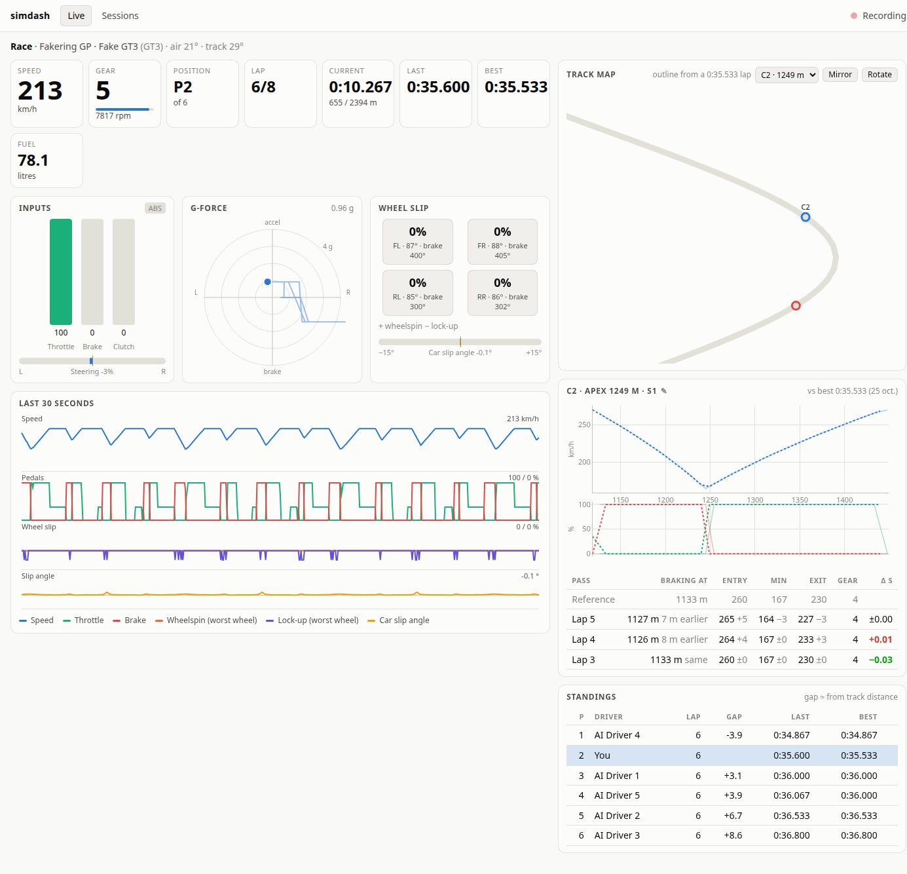

# Live

[← simdash](../README.md)

The dashboard while you drive. It fills as soon as AMS2 is on track and records the session in the
background (see [data and storage](data.md)).

*The dashboard on track, with the track map focused on one corner and each pass compared with the
reference lap (here fed by the built-in fake game, `simdash.fake_ams2`).*

## What it shows

- **Car:** speed, gear, RPM, position, lap times, fuel; throttle, brake, clutch and steering.
- **G-force circle** with a 3 s trail.
- **Wheel slip:** spin or lock per wheel, and the car's slip angle. AMS2 gives no slip ratio, so simdash
  learns each wheel's size per car first (it shows "learning" until then; see [data](data.md)).
- **Rolling chart** of the last 30 s.
- **Track map** with every car, track edges in natural colours where they are mapped
  ([Track edges](track-edges.md)), and beside it the car seen from above with each bass shaker lit by
  what monocoque is playing on it ([Shakers](shakers.md#shakers-on-the-live-and-sessions-maps)).
- **Standings** with approximate gaps.

## Corner focus

Pick a corner of your best lap (same track layout and car, from any day) on the track map to zoom on it.
Each pass through it then shows its live speed and pedals over the reference lap, and a row with the
braking point, entry / minimum / exit speed and the time gained or lost. Corners are found as described
in [corners](corners.md).

The [Corner Genie](corner-genie.md) popup uses the same reference lap and shows over this page too.

## Tips

- Opening simdash on the game PC while AMS2 runs takes the focus from AMS2, which then loses the wheel:
  use a second screen opened before the race, or a phone or tablet (`simdash --host 0.0.0.0`).
- The map orientation is a guess: use **Mirror** / **Rotate** once per setup (remembered in the browser).
