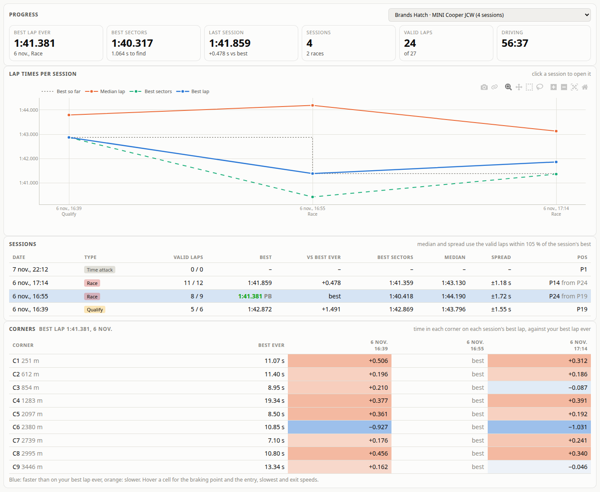

# Progress

[← simdash](../README.md)

One track layout with one car, over every session you drove it. Pick the combination at the top, or use
**Progress on this track** from a session ([Sessions](sessions.md)). Link: `/#progress`.

*Brands Hatch in the MINI Cooper JCW over four sessions: the best lap came in the 16:55 race, which was
also the best in every corner; the 17:14 race was faster than it only in C3 and C6 (blue).*

- **Tiles:** best lap ever, best sectors (the three best sector times added up, and how far that is from
  the best lap), last session against the best, sessions, valid laps, driving time.
- **Lap times per session:** each session's best lap, its median lap, its best sectors, and the best so
  far as a step line. Click a session to open it.
- **Sessions table:** valid laps, best lap (PB marks a new personal best), gap to the best ever, best
  sectors, median and spread (over the valid laps within 105 % of that session's best, so a spin does
  not count), and the position.
- **Corners:** the time in each corner on each session's best lap, against your best lap ever: blue is
  faster, orange slower, the stronger the bigger. Hover a cell for the braking point and the entry,
  slowest and exit speeds. Corners are those of the best lap ([how](corners.md)).

To compare single passes through one corner across sessions and cars, use
[Corner Genie → Corner passes](corner-genie.md#corner-passes).
