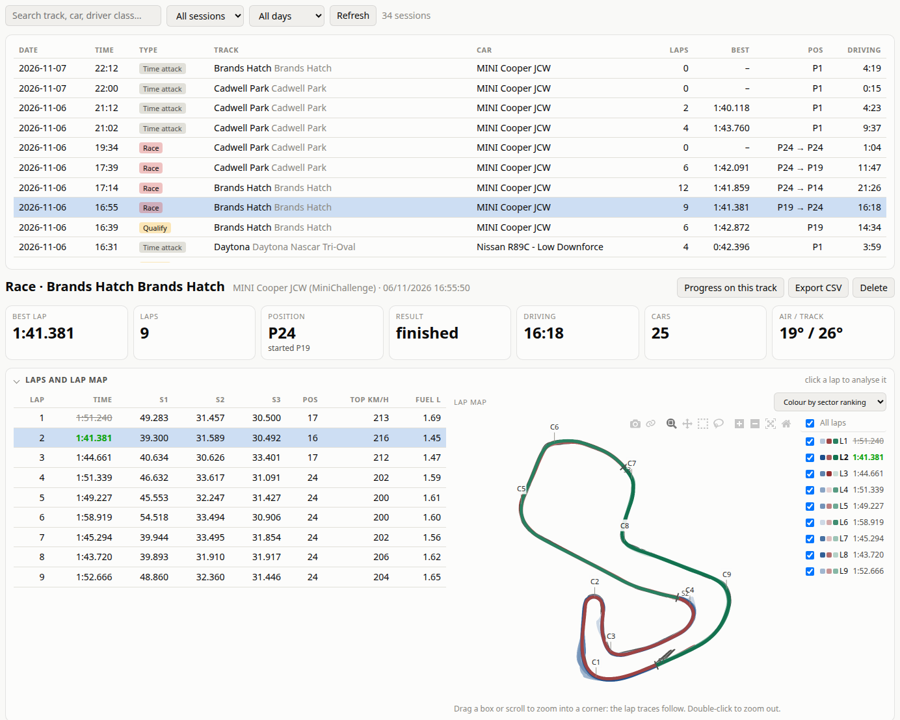
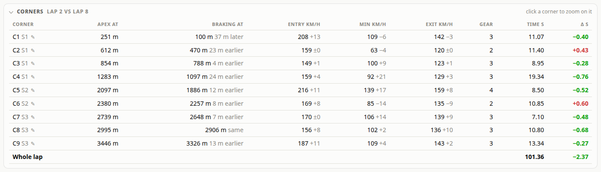
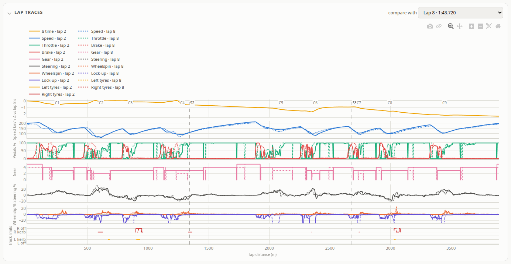
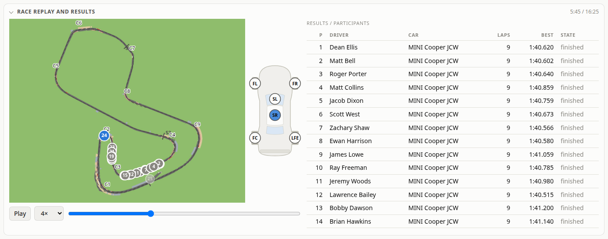

# Sessions

[← simdash](../README.md)

Every recorded session from every day, searchable by track, car or driver class, and filterable by
session type and day. Click one to analyse it. Links like `/#session=2026-10-25:3` open a session directly.

*A race at Brands Hatch: summary tiles (best lap, position, result, driving time, weather), then the laps
with their sectors, top speed and fuel, and the lap map coloured by sector ranking (one hue per sector,
darker = faster among the shown laps). Lap 1 is struck through: invalid.*

## Laps and lap map

- **Laps table:** time, sectors, position, top speed and fuel used per lap. Click a lap to analyse it.
- **Lap map:** colour by speed, throttle / brake, wheel slip (lock ← → spin), track limits (kerbs and off
  track), surface (AMS2's raw terrain under each tyre), sector ranking, or one colour per lap. Tick laps on the right to overlay
  them. Corner names and sector lines are drawn on it; track edges show when they are mapped.
- **Zoom:** drag a box or scroll on the map to zoom into a corner, and the lap traces follow.

## Corners

*Lap 2 against lap 8: for each corner, where it is, where you braked (and how much earlier or later than
the other lap), the entry, slowest and exit speeds, the gear, the time in the corner and the time gained
(green) or lost (red).*

Corners are found from the lap's speed ([how](corners.md)). The table compares the analysed lap with the
compare lap, or with the session's best when there is none. Click a corner to zoom the map and traces on it;
click ✎ to name it (names are kept per track layout and shown everywhere).

## Lap traces

*Lap 2 (solid) against lap 8 (dotted): the time delta along the lap, speed, pedals, gear, steering, wheel
slip, and a track-limits row with the left and right tyres on a kerb or off track. Dashed lines mark the
sector starts, corner names sit along the top.*

**Compare with** offers every lap of the session and the best laps of other sessions (any day) on the same
track layout with the same car.

## Race replay and results

*Five minutes into the race: every car on the map (you in blue), the car seen from above with each shaker lit
by what monocoque played at that moment, and the results.*

- **Replay** all cars at 1×, 4× or 16×, or drag the slider. The small car shows the shakers as they played
  ([how](shakers.md#shakers-on-the-live-and-sessions-maps)).
- **Results:** position, driver, car, laps, best lap, state.
- **Position over the session:** everyone's position along the race; click it to move the replay there.

## Session actions

- **Progress on this track** opens [Progress](progress.md) for this track and car.
- **Export CSV** downloads every sample of the session.
- **Delete** removes the session from its day's database.
