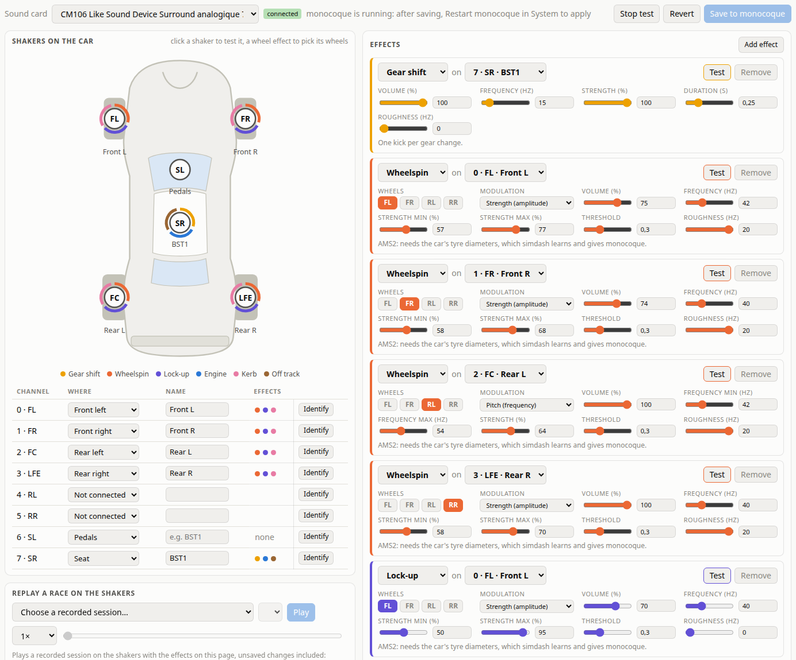
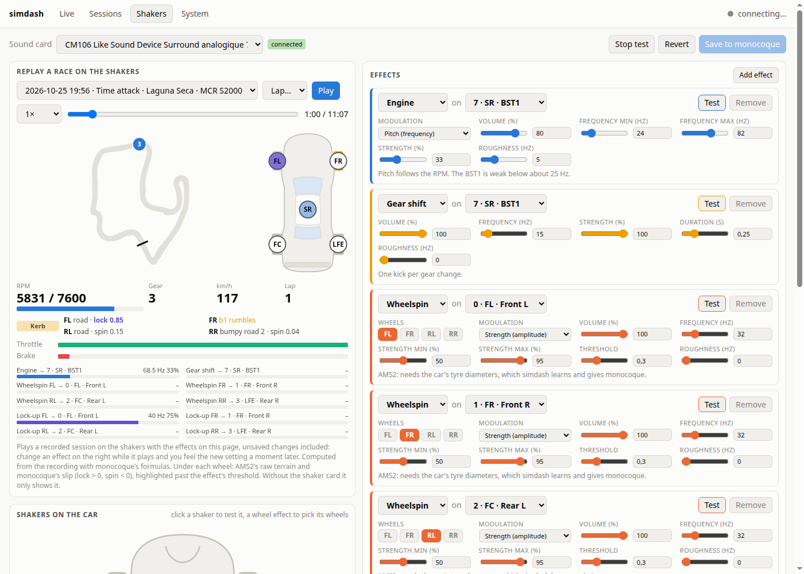

# Shakers

[← simdash](../README.md)

Bass shaker setup for [Monocoque](https://github.com/Spacefreak18/monocoque), plus kerb, off-track and oversteer
effects simdash plays itself. Link: `/#shakers`.

*Where each channel of the 7.1 shaker card is mounted (one per wheel, BST1 under the seat), the effects each
one plays (coloured dots), and on the right the effects with their wheels, modulation, frequency, strength
and threshold.*

## Setup

simdash edits the `Sound` effects of the default entry in `~/.config/monocoque/monocoque.config` (other
devices and per-car entries are kept). Saving rewrites the file with a comment per effect and keeps the
previous one as `monocoque.config.bak-<date-time>`. monocoque reads its config when it starts: after saving,
use **Restart monocoque** on the [System](system.md) tab, or start a new session.

- **Shakers on the car:** where each of the 8 channels (7.1 order FL, FR, FC, LFE, RL, RR, SL, SR) is
  mounted is simdash's own data (`shakers.json`); monocoque only knows channel numbers (`pan`).
  **Identify** pulses one channel to find which shaker it is.
- **Effects** (engine, gear shift, wheelspin, lock-up, ABS, suspension): shaker, wheels, modulation,
  frequency, strength, threshold and volume each, with a **Test** button that plays it as monocoque would.
- **Tests** are synthesised like monocoque's PulseAudio streams (a sine at `amplitude`%, stream volume
  `volume`%, one channel of 8) and played with `pacat`, only on the shaker card chosen at the top: if it is
  unplugged the test is refused rather than played on the speakers.
- **Wheels:** monocoque's `tyre` takes one wheel, `Fronts`, `Rears` or `All`. Any other set picked on the car
  (one side, a diagonal, three wheels) is saved as one effect per part on the same shaker, each 3 Hz above
  the previous so the sines add up instead of cancelling, tagged with a `group` key that monocoque ignores
  so simdash shows them as one effect again.
- **monocoque plays every effect at 8× its frequency on a 7.1 card** (as of monocoque `47d0c50`): its
  PulseAudio callbacks advance the sine once per 16-bit value instead of once per frame of interleaved
  channels, so a 30 Hz effect comes out at 240 Hz and gear kicks last 1/8 of their duration. The setup this
  was written for runs monocoque with a local fix (one time step per frame, the sample copied to every
  channel); without it, the Tests and the replay here feel lower than the car.
- AMS2 notes shown per effect: wheelspin and lock-up need each car's tyre diameters, which simdash gives
  monocoque (below); ABS probably never fires and suspension gives nothing (simapi does not map AMS2's
  suspension, so kerbs cannot be felt through monocoque).

## Kerbs and off track (played by simdash)

monocoque has no effect for the track surface, and its Suspension effect gets nothing from AMS2, so simdash
adds two effects of its own: **Kerb** (rumble strips, kerbs, drains) and **Off track** (grass, gravel, sand,
runoff...). Each takes any set of wheels and plays while one of them is on that surface, from AMS2's raw
terrain per wheel (`mTerrain`), with its pitch or strength rising with speed (full at 200 km/h).

simdash plays them itself on the shaker card next to monocoque (PulseAudio mixes the two), so they need
simdash running but no monocoque restart: they apply a few seconds after saving. They are saved in simdash's
`effects.json`, never in `monocoque.config`, and show in the replay and on the small cars.

## Oversteer (played by simdash)

A hint that the rear is stepping out, before you have to countersteer. simdash computes the **rear slip
angle**, how far the rear axle slides sideways, from AMS2's velocity and yaw rate:
`atan(|sideways speed − yaw rate × 1.3 m| / forward speed)` (in AMS2 positive yaw is a left turn and the car's
X axis points left: a clockwise lap adds up to −360°; the rear axle is assumed 1.3 m behind the centre). A few degrees is normal grip. The effect starts at **Starts at** (5° by
default) and reaches its max strength at **Full at** (10°), so a small slide gives a light buzz and a real one a
strong one. Nothing plays below 8 m/s.

Its wheels say which way: **RL** plays while the rear slides to the left (in a right-hand corner), **RR** while it
slides to the right. One Oversteer effect with RL on the rear-left shaker and one with RR on the rear-right shaker
tell you which way the car is going; both wheels on one shaker plays either way. Only the rear has a direction:
both rear tyres slide sideways together, and a front tyre's slip angle needs the steering lock, which AMS2 does
not give.

On the recorded laps it was set up with (MINI at Brands Hatch, Aston Martin GT3 at Spa) the defaults play 4 to 6
times a minute, about 5–7 % of the driving, close to how often you countersteer. Lower the start for an earlier
hint, raise it if it plays in every corner. The Live page shows the rear slip angle next to the car slip angle,
red past the start. It needs no wheels and no monocoque restart, and plays in the replay too.

## Replay on the shakers

*A lap at Laguna Seca replayed on the shakers while the effects are tuned on the right: braking with the
front-left wheel locked (its puck lit violet), the front-right on a kerb, the engine on the BST1 under the seat.*

Pick a recorded session, then Play (0.25×, 0.5× or 1×), drag the slider or jump to a lap. The replay card
stays in view while you scroll the effects, and uses them as they are on the page, unsaved changes included:
change a threshold or a strength while it plays and you feel the new setting a moment later. It shows the
track map, a small car with each shaker lit by what it plays, RPM against the car's max, gear, speed, pedals,
each effect's frequency and strength, whether the car is on track, on a kerb or off track, and under each
wheel its terrain name and monocoque's slip (lock > 0, spin < 0), highlighted past the threshold of that
wheel's effect. The code is `simdash/replay.py`.

- Each effect is recomputed from the recorded telemetry (20 Hz, interpolated) with monocoque's formulas:
  engine = `rpm / max rpm`; a gear kick when the gear changes to 1st or above; wheelspin and lock-up from
  each wheel's speed (`tyre diameter × rps / 2`) against the car's, past the threshold, only while moving
  forwards. ABS fires only while AMS2's ABS flag is on; suspension gives nothing, as in the car.
- The streams are mixed into one 8-channel signal (stream volumes as PulseAudio applies them) and played
  with `pacat` on the shaker card only. Without the card the replay runs silently for the map and the car.
  Slower replays keep each vibration's pitch and each gear kick's length.

## Tyre diameters for monocoque

Wheelspin and lock-up need each car's tyre diameters, in monocoque's `diameters.config`:
`~/.config/monocoque/` up to monocoque `47d0c50`, `~/.cache/monocoque/` from `9be899e` on. simdash looks
inside the monocoque that `start-monocoque` runs (the older path is written in the program) and uses that
file only; the first time it writes the new one, it carries over the cars monocoque learned in the old one.

monocoque only learns diameters itself while coasting above 50 km/h with the brake at exactly 0, which a
resting foot never gives, so simdash writes the sizes it learns (`wheels.json`, diameter = 2 × radius) into
that file, tagged `source = "simdash"`: at start and each time it learns or refines a car. Cars monocoque
learned itself are left alone, and the previous file is kept as `diameters.config.bak-<date-time>`.

## Shakers on the Live and Sessions maps

The small car next to the [Live](live.md) track map and the [session](sessions.md)'s race replay shows each
shaker lit in the colour of the strongest effect it plays, computed like the replay above. Live uses the
settings monocoque started with (it reads its config only at start). A recorded session uses the settings in
force when it started: saving keeps the previous file as `monocoque.config.bak-<date-time>`, so the first
backup made after the session start holds them (the current file if none). Where each channel sits on the
car comes from today's `shakers.json`, which has no history.

## simdash's haptics engine (instead of monocoque)

Tick **played by simdash** next to *Shakers* (System tab, AMS2 card, or the ▾ menu by Start AMS2) and
simdash plays every shaker effect itself, from the same settings, in place of monocoque. During a
session the switch takes effect at once (one stops, the other starts), so the two can be compared on
the same lap.

The engine (`simdash/engine.py`, launched as `~/.local/bin/simdash-haptics`) is a process of its own,
so the recorder, the database and the web pages never hold it up. Every 10 ms it reads AMS2's shared
memory directly (no simd in between), works out each effect with the formulas the replay uses, and
writes 10 ms of 8-channel sound to the shaker card through libpulse-simple with about 30 ms buffered:
roughly 40-50 ms from the game to the seat. Its writes wait on the card, so the card's clock sets the
pace and nothing drifts. Saved settings and haptics presets apply at once, without a restart.

The System tab's *simdash haptics engine* card shows what it measures each second: telemetry updates
read, synthesis time per block, latency to the card and dropouts (blocks that came too late).

## Suspension (bumps)

Played by simdash (monocoque never got AMS2's suspension through simapi): how fast the chosen wheels'
suspension moves, AMS2's `mSuspensionVelocity`, in m/s up or down. Cornering and braking move it
slowly (on track 99 % of samples stay under 0.11 m/s); kerbs reach 0.2-0.4 m/s, landings and off-track
0.4-1. The effect starts at *Starts at* (default 0.08 m/s) and is full at *Full at* (0.4 m/s). With the
haptics engine the suspension is read every 10 ms and each hit fades over 60 ms, so a single sharp bump
is felt; one effect per corner shaker, each on its own wheel, places the bump where it happens. On a
recorded Interlagos session (McLaren GT3) it played 2-6 % of the time on track and about 30 % on kerbs.

## Impact (obstacles)

Played by simdash: walls, barriers and other cars, from a sudden jump of the car's horizontal acceleration
(AMS2 `mLocalAcceleration`, sideways and forward/backward) away from its level over the last quarter second.
Steady cornering and braking never count, even the 5-6 g of a formula car; on recorded laps (2026-11-20)
driving moves it about 1 g from one sample to the next, while hits gave 6 to 20 g (a single absurd sample,
401 g, is ignored). *Starts at* 3 g, *Full at* 12 g; each knock fades over 150 ms. The car is pushed away
from what it hits, so the wheels pick the side the obstacle is on: an effect on FL plays for a front-left
hit, all four wheels play for any hit (the seat shaker). Vertical jolts (landings) are left to Suspension.
