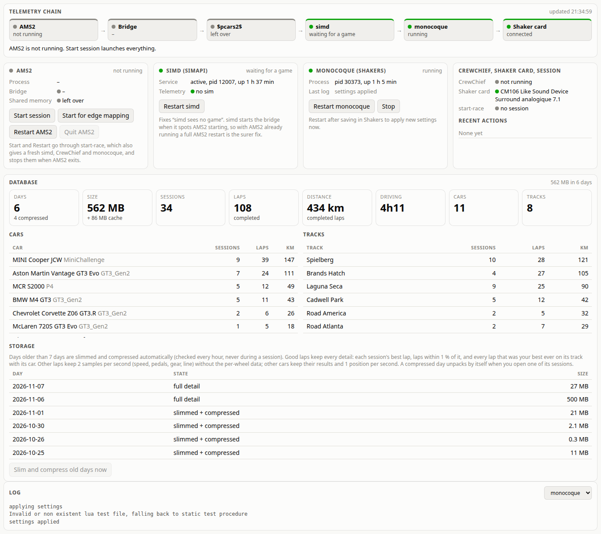

# System

[← simdash](../README.md)

The telemetry chain at a glance, with the buttons to fix it and the size of what is recorded. Link: `/#system`.

*AMS2 closed, simd waiting for a game, monocoque running with the shaker card connected; below, the
database: 34 sessions over 6 days, 4 of them compressed.*

## Telemetry chain

AMS2 → pcars2bridge → `$pcars2$` → simd → monocoque → shaker card, plus CrewChief and the race session,
each green / yellow / red with the fix for the first broken link. Buttons restart simd, restart or stop
monocoque, and start, restart or quit AMS2; a log viewer tails each tool's log.

It expects the launchers of the setup it was written for in `~/.local/bin`: `start-race` (one session:
restarts simd, starts CrewChief, AMS2 through Steam and monocoque, stops them when AMS2 exits; logs in
`~/.local/state/`), `start-monocoque` and `simtelemetry` (simd's data check). simd runs as the systemd user
service `simd`. **Start session** and **Restart AMS2** run `start-race`; **Quit AMS2** ends the game process and waits for
`start-race` to clean up.

Opening the page on the game PC while AMS2 runs moves the focus away from AMS2, which then loses the wheel:
use it from a phone or tablet (`simdash --host 0.0.0.0`) during a race.

A restarted simd deletes `/dev/shm/SIMAPI.DAT` and creates a new one, so a monocoque started before it keeps
reading the old copy, which no longer changes, and plays nothing that follows the race. **Restart simd**
therefore restarts a running monocoque too, and monocoque shows red ("reads an old simd") when it still maps
a deleted `SIMAPI.DAT`. The `start-race` used here also stops such a monocoque after restarting simd, before
starting its own.

## Database

Totals over every day (sessions, laps, distance, driving time, per car and per track), and each day's
storage state: full detail, or slimmed and compressed once it is 7 days old. **Slim and compress old days
now** runs it by hand. Details in [data and storage](data.md).
