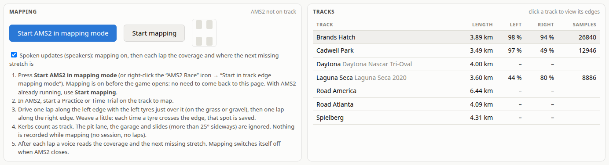
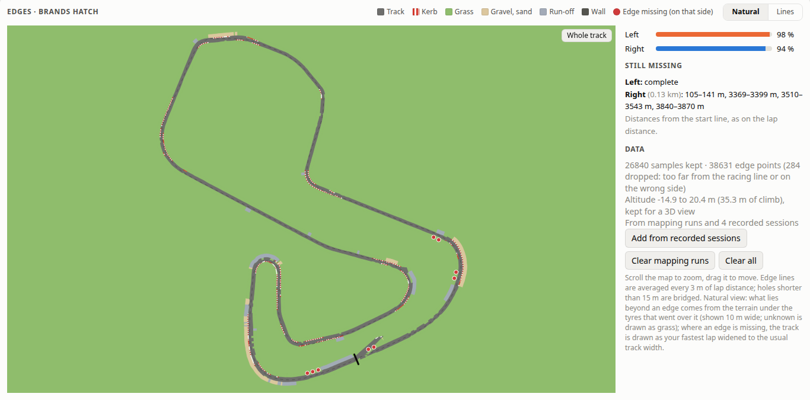
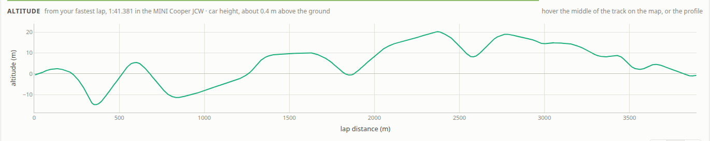
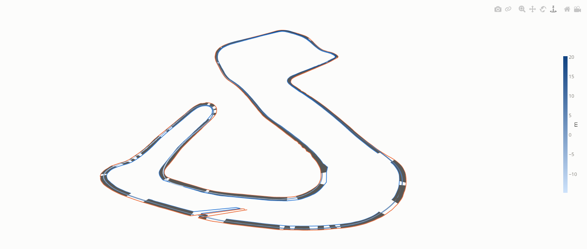

# Track edges

[← simdash](../README.md)

AMS2 gives no track boundaries, only the surface under each tyre. So simdash learns them: drive along each
edge with the outside tyres just over it, and every time a tyre crosses between track/kerb and grass,
gravel or run-off, that spot is saved as edge (one axle straddling the edge counts too, weighted less).
Points are averaged every 3 m of lap distance into a left and a right line. Link: `/#edges`.

*Mapping controls and the steps to follow, next to every track with its length, the coverage of each side
and the samples kept.*

## Mapping

- **Mapping mode:** *Start AMS2 in mapping mode* (or `start-race --map`) starts AMS2 without CrewChief with
  mapping already on, so you never leave the game (switching window drops the wheel). With AMS2 already
  running, use *Start mapping*.
- While mapping, nothing is recorded (no session, no laps), the [Corner Genie](corner-genie.md) stays quiet,
  and a voice (`spd-say`) reads after each lap the coverage of each side and where the next hole is, by
  corner name when you named it. Mapping switches itself off 30 s after AMS2 closes.
- The pit lane, the garage and slides over 25° are ignored.
- **From your sessions:** *Add from recorded sessions* takes every off-track moment of your recorded laps on
  that layout, so a track is partly mapped before you start.

## Views

*Brands Hatch, 98 % of the left edge and 94 % of the right one mapped. Red dots mark where an edge is still
missing on that side; the list on the right gives those stretches by lap distance.*

- **Natural:** grass everywhere, tarmac between the edges, red and white kerbs where tyres ran on them and,
  beyond each edge, what the tyres found there (gravel, run-off, wall; drawn 10 m wide). Also on the Live map.
- **Lines:** the left and right edges as lines. Scroll to zoom, drag to move.
- **Coverage** per side and the missing stretches.

*Altitude from the fastest recorded lap: 35 m of climb at Brands Hatch. Hover the profile, or the middle of
the track on the map, to link the two.*

*3D view with height ×3, the edges in their side colours. Drag to turn, scroll to zoom, right-drag to move.*

## Files and limits

- `~/.local/share/simdash/tracks/<track>.edges.json` keeps the raw samples (lap distance, position, heading,
  surface and terrain code under each tyre, altitude), so the lines can be rebuilt as the method improves.
  Mapping on/off and the voice setting: `mapping.json`.
- The car's size is assumed (tyres 0.8 m either side, axles 1.3 m from the centre), so edges are good to
  about half a metre; altitude is the car's centre of mass, about 0.4 m above the ground.
- On a track with no recorded lap yet, drive one normal lap first: the outline, altitude and corners come
  from recorded laps.
