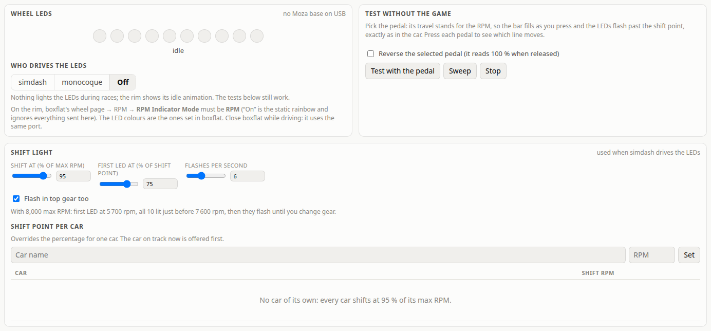

# Wheel LEDs

[← simdash](../README.md)

Shelved on 2026-11-06, back since 2026-11-20 (button visible, simdash drives the LEDs). Note that
monocoque's own Moza drivers send nothing since monocoque `18f043a` (they write only
`if (serialdevice->port)`, a field that commit stopped setting), so only the *simdash* choice lights the LEDs.

For a Moza base whose rim has RPM LEDs (tested on an old R5 base with the ES rim). The frame is monocoque's
`MozaR5` one, written to the base's serial port (`/dev/serial/by-id/usb-Gudsen_MOZA*-if00`):
`7e 06 41 13 fd de` + a 4-byte big-endian mask (bits 0–9 = the 10 LEDs) + checksum (`0x0d` + the sum of the
bytes, mod 256). The rim only listens when boxflat's wheel page → RPM → **RPM Indicator Mode** is **RPM**
("On" is a static rainbow). Colours stay the ones set in boxflat.

- **Who drives the LEDs:** *simdash* lights them from the live RPM with the shift light settings; *monocoque*
  uses its fixed steps (10–92 % of max RPM, flashing from 94 %); *Off* leaves the rim alone. Only one program
  may write to the port, so monocoque's Moza device is added to `monocoque.config` only when monocoque is
  chosen (with a backup, like the [Shakers](shakers.md) tab). Restart monocoque after switching.
- **Shift light:** the bar starts at a share of the shift point and is full just before it; from the shift
  point all LEDs flash until you change gear (not in top gear, unless asked). The shift point is a share of
  the car's max RPM, or an RPM set per car. Settings in `~/.local/share/simdash/leds.json`.
- **Test without the game:** each pedal is an axis of the base's joystick device
  (`/dev/input/by-id/usb-Gudsen_MOZA*-event-joystick`, read with `EVIOCGABS`); the chosen pedal's travel
  stands for RPM / max RPM. *Sweep* runs the bar and the flash on its own.
