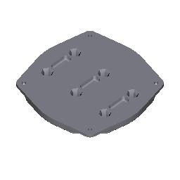
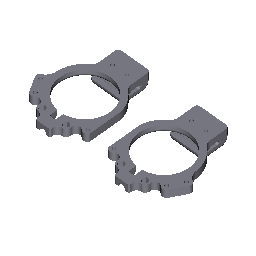
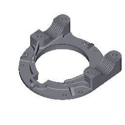
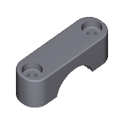

# Shaker mounts

[← Hardware](../README.md) · [Shakers tab](../../docs/shakers.md)

3D-printed parts that hold the bass shakers on the rig, designed in FreeCAD.

> **Still to fill in:** marked _like this_. Rig description from simdash's settings; correct it if the
> hardware has changed.

## The rig

| Channel (7.1 card) | Where | Shaker | Mount |
|---|---|---|---|
| 0 · FL | front left (wheel) | corner puck | [front-puck-mount](#front-puck-mount) |
| 1 · FR | front right | corner puck | [front-puck-mount](#front-puck-mount) |
| 2 · FC | rear left | corner puck | [rear-puck-mount](#rear-puck-mount) |
| 3 · LFE | rear right | corner puck | [rear-puck-mount](#rear-puck-mount) |
| 7 · SR | under the seat | BST1 | [seat-bst1-mount](#seat-bst1-mount) |

Card: ICUSBAUDIO7D USB 7.1. Which effects play where: the [Shakers](../../docs/shakers.md) tab.
_Check the Mount column: it is inferred from the parts' names and shapes._

## Files

Each part has the same name everywhere:

| Folder | What |
|---|---|
| [`freecad/`](freecad/) | FreeCAD sources (`.FCStd`): edit these |
| [`print/`](print/) | exports ready to slice (`.3mf`) |
| [`img/`](img/) | renders of the parts (from the 3MF thumbnails) and photos of the rig |

## Parts

Sizes are the bounding box of the exported part, in mm.

| Part | Source | Print file | Size (mm) | Qty | Fits / holds | Print settings |
|---|---|---|---|---|---|---|
| [seat-bst1-mount](#seat-bst1-mount) | [`freecad/seat-bst1-mount.FCStd`](freecad/seat-bst1-mount.FCStd) | [`print/seat-bst1-mount.3mf`](print/seat-bst1-mount.3mf) | 136 × 136 × 22 | 1 | _BST1 under the seat; fixed to …_ | _…_ |
| [front-puck-mount](#front-puck-mount) | [`freecad/front-puck-mount.FCStd`](freecad/front-puck-mount.FCStd) | [`print/front-puck-mount.3mf`](print/front-puck-mount.3mf) | 213 × 125 × 22 (both) | 1 file, 2 parts | _a corner puck each; fixed to …_ | _…_ |
| [rear-puck-mount](#rear-puck-mount) | [`freecad/rear-puck-mount.FCStd`](freecad/rear-puck-mount.FCStd) | [`print/rear-puck-mount.3mf`](print/rear-puck-mount.3mf) | 105 × 105.5 × 22 | _2?_ | _a corner puck; saddles on a … mm tube_ | _…_ |
| [tube-half-clamp](#tube-half-clamp) | [`freecad/tube-half-clamp.FCStd`](freecad/tube-half-clamp.FCStd) | [`print/tube-half-clamp.3mf`](print/tube-half-clamp.3mf) | 18 × 56 × 18.7 | _…_ | _closes a saddle around a tube?_ | _…_ |

### seat-bst1-mount

Square plate with rounded corners, slotted holes and corner holes. _What it bolts to, which holes take the BST1._

### front-puck-mount

Two rings with a clamping tab each, printed together. _What they clamp to._

### rear-puck-mount

A ring for the puck with two ribbed saddles. _The tube it sits on; with the half clamp?_

### tube-half-clamp

Half-round clamp, two counterbored screw holes, 18 mm wide. _What it closes around and how many are needed._

### Hardware needed

| Item | Qty | For |
|---|---|---|
| _screws, nuts, inserts, rubber…_ | | |

## Assembly

1. _…_

## Photos on the rig

<!-- Add pictures to img/ (rig-<where>.jpg) and show them like this:

*What the photo shows, in one sentence.*
-->

_No photos yet._

## Notes

Things worth keeping from the shaker tuning (details in [haptics notes](../../docs/haptics-notes.md)):

- Coupling matters more than power: a shaker on a part that flexes or rattles is felt weakly and heard loudly.
  The BST1 felt weak while it sat on a tube the body wasn't touching.
- The BST1 is weak below ~25 Hz.
- _What worked / what didn't with these mounts (material, stiffness, rubber or not)._
